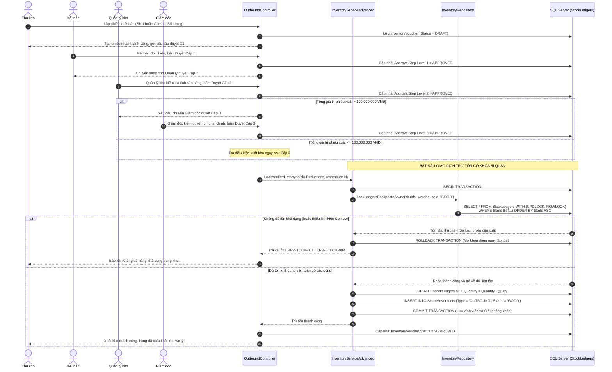
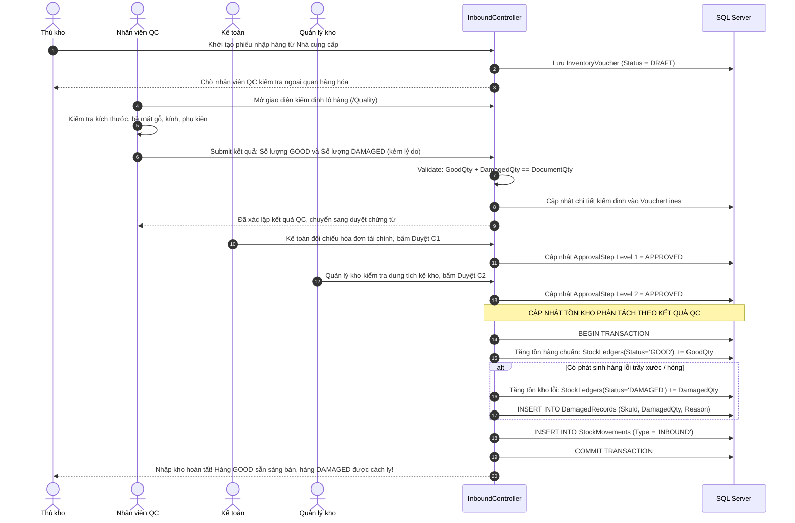
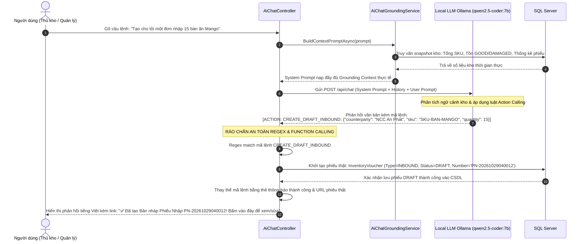
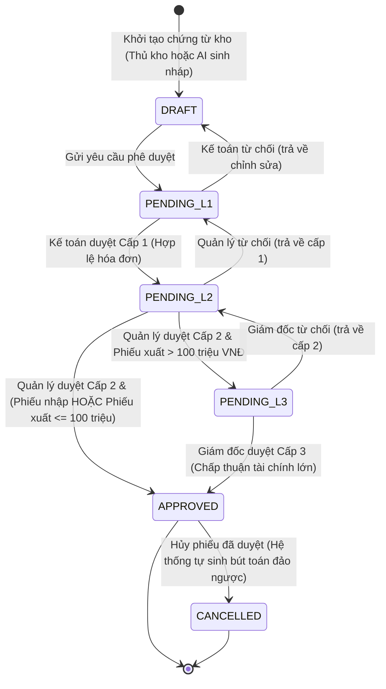
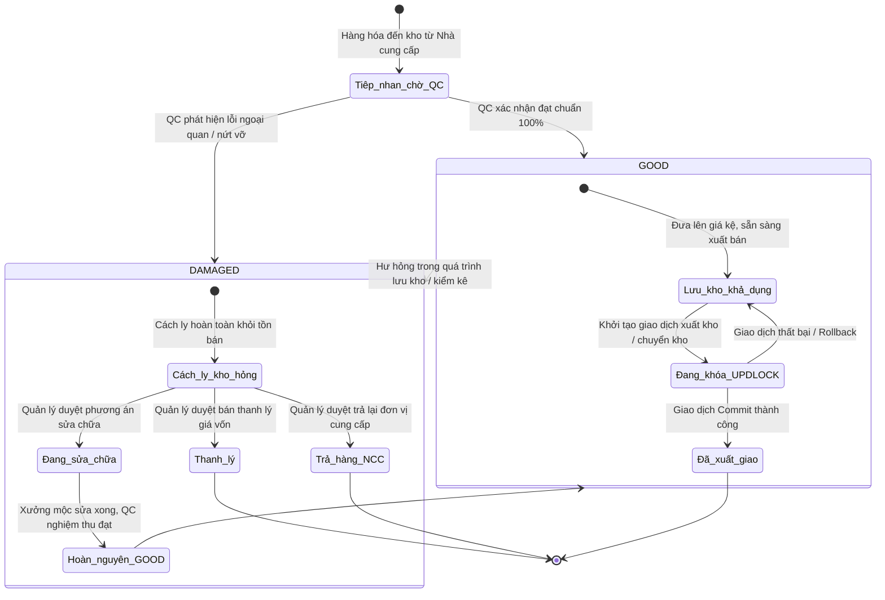

# ĐẶC TẢ YÊU CẦU PHẦN MỀM (SOFTWARE REQUIREMENTS SPECIFICATION - SRS)
## HỆ THỐNG QUẢN LÝ KHO HÀNG NỘI THẤT TÍCH HỢP AI (FURNITURE WMS WITH INTEGRATED AI)
### Tiêu chuẩn áp dụng: IEEE Std 830-1998 / ISO/IEC/IEEE 29148:2018
#### Phiên bản: 1.0 (Baseline Hoàn thiện Thực tế theo Kiến trúc & Mã nguồn .NET 9)

---

> **Học phần:** Ứng dụng Trí tuệ Nhân tạo trong Phát triển Phần mềm (GenAI Software Development)  
> **Khoa:** Công nghệ Thông tin – Trường Đại học Công nghệ Thông tin & Truyền thông (ICTU) – Đại học Thái Nguyên  
> **Nhóm thực hiện:** Nhóm 7  
> **Thành viên thực hiện đề tài:**  
> - **Nguyễn Đức Hiếu** (Trưởng nhóm – Kiến trúc phần mềm, Backend Core, AI Integration & Automated Testing)  
> - **Trần Minh Hiếu** (Thành viên – Database Design, Master Data, UI/UX & QA Testing)  
> **Thời gian thực hiện:** Năm học 2025 – 2026  
> **Trạng thái tài liệu:** Đã nghiệm thu thực tế • Build Success (.NET 9) • 36/36 Automated xUnit Tests Passed  

---

| Thông tin tài liệu | Giá trị đặc tả |
| :--- | :--- |
| **Mã tài liệu** | `SRS-WMS-AI-FURNITURE-001` |
| **Tên tài liệu** | Đặc tả Yêu cầu Phần mềm Hệ thống Quản lý Kho Hàng Nội thất Tích hợp AI |
| **Phiên bản** | v1.0 (Bản chuẩn hóa theo mã nguồn thực tế) |
| **Tài liệu nguồn đầu vào** | `URD-WMS-AI-FURNITURE-002` (URD v2.0 – Nhóm 7) |
| **Đối tượng độc giả** | Kiến trúc sư hệ thống, Kỹ sư phần mềm (Backend/Frontend), Kỹ sư AI/Prompt Engineer, Kỹ sư QA/QC Test, Ban Giám đốc |
| **Môi trường công nghệ** | .NET 9.0 ASP.NET Core MVC (C# 13), EF Core 9, SQL Server 2022 (32 bảng), Local LLM Ollama (`qwen2.5-coder:7b`) |

---

## 📌 MỤC LỤC CHI TIẾT

1. [Giới thiệu tổng quan hệ thống phần mềm](#1-giới-thiệu-tổng-quan-hệ-thống-phần-mềm)  
   1.1. [Mục đích tài liệu](#11-mục-đích-tài-liệu)  
   1.2. [Phạm vi sản phẩm phần mềm](#12-phạm-vi-sản-phẩm-phần-mềm)  
   1.3. [Định nghĩa, từ viết tắt và ký hiệu quy ước](#13-định-nghĩa-từ-viết-tắt-và-ký-hiệu-quy-ước)  
   1.4. [Tài liệu tham chiếu](#14-tài-liệu-tham-chiếu)  
   1.5. [Cấu trúc tổng quan tài liệu](#15-cấu-trúc-tổng-quan-tài-liệu)  
2. [Mô tả tổng thể hệ thống (Overall Description)](#2-mô-tả-tổng-thể-hệ-thống-overall-description)  
   2.1. [Bối cảnh sản phẩm & Kiến trúc Clean Layered Architecture](#21-bối-cảnh-sản-phẩm--kiến-trúc-clean-layered-architecture)  
   2.2. [Giao diện người dùng & Giao diện phần mềm](#22-giao-diện-người-dùng--giao-diện-phần-mềm)  
   2.3. [Phân tích 6 Actor & Ma trận phân quyền RBAC chi tiết](#23-phân-tích-6-actor--ma-trận-phân-quyền-rbac-chi-tiết)  
   2.4. [Môi trường vận hành & Công nghệ triển khai](#24-môi-trường-vận-hành--công-nghệ-triển-khai)  
   2.5. [Ràng buộc thiết kế & Nguyên tắc triển khai cốt lõi](#25-ràng-buộc-thiết-kế--nguyên-tắc-triển-khai-cốt-lõi)  
3. [Đặc tả yêu cầu chức năng phần mềm chi tiết (Functional Requirements)](#3-đặc-tả-yêu-cầu-chức-năng-phần-mềm-chi-tiết-functional-requirements)  
   3.1. [Phân hệ Dữ liệu gốc (Master Data Management: SRS-F-01 $\rightarrow$ SRS-F-05)](#31-phân-hệ-dữ-liệu-gốc-master-data-management-srs-f-01-rightarrow-srs-f-05)  
   3.2. [Phân hệ Nhập kho & Kiểm định chất lượng (Inbound & QC: SRS-F-06 $\rightarrow$ SRS-F-08)](#32-phân-hệ-nhập-kho--kiểm-định-chất-lượng-inbound--qc-srs-f-06-rightarrow-srs-f-08)  
   3.3. [Phân hệ Xuất kho & Khóa bi quan (Outbound & Concurrency Control: SRS-F-09 $\rightarrow$ SRS-F-12)](#33-phân-hệ-xuất-kho--khóa-bi-quan-outbound--concurrency-control-srs-f-09-rightarrow-srs-f-12)  
   3.4. [Phân hệ Điều chuyển kho nội bộ (Stock Transfer: SRS-F-13)](#34-phân-hệ-điều-chuyển-kho-nội-bộ-stock-transfer-srs-f-13)  
   3.5. [Phân hệ Kiểm kê & Cân chỉnh tồn (Inventory Audit & Adjustment: SRS-F-14 $\rightarrow$ SRS-F-15)](#35-phân-hệ-kiểm-kê--cân-chỉnh-tồn-inventory-audit--adjustment-srs-f-14-rightarrow-srs-f-15)  
   3.6. [Phân hệ Quản lý Hàng lỗi (Damaged Stock Management: SRS-F-16)](#36-phân-hệ-quản-lý-hàng-lỗi-damaged-stock-management-srs-f-16)  
   3.7. [Phân hệ Phê duyệt chứng từ đa cấp (Approval Workflow: SRS-F-17)](#37-phân-hệ-phê-duyệt-chứng-từ-đa-cấp-approval-workflow-srs-f-17)  
   3.8. [Phân hệ Báo cáo & Thống kê (Reporting & Analytics: SRS-F-18 $\rightarrow$ SRS-F-20)](#38-phân-hệ-báo-cáo--thống-kê-reporting--analytics-srs-f-18-rightarrow-srs-f-20)  
   3.9. [Phân hệ Quản trị hệ thống, Nhật ký & Sao lưu (Admin, Audit & Backup: SRS-F-21 $\rightarrow$ SRS-F-23)](#39-phân-hệ-quản-trị-hệ-thống-nhật-ký--sao-lưu-admin-audit--backup-srs-f-21-rightarrow-srs-f-23)  
   3.10. [Phân hệ Tra cứu thông tin nhanh (Quick Search: SRS-F-24)](#310-phân-hệ-tra-cứu-thông-tin-nhanh-quick-search-srs-f-24)  
4. [Đặc tả yêu cầu Trí tuệ nhân tạo (AI Requirements: SRS-AI-01 $\rightarrow$ SRS-AI-06)](#4-đặc-tả-yêu-cầu-trí-tuệ-nhân-tạo-ai-requirements-srs-ai-01-rightarrow-srs-ai-06)  
   4.1. [SRS-AI-01: Thuật toán Dự báo Bổ sung hàng tồn kho (Replenishment Engine)](#41-srs-ai-01-thuật-toán-dự-báo-bổ-sung-hàng-tồn-kho-replenishment-engine)  
   4.2. [SRS-AI-02: Thuật toán Phát hiện Biến động nhu cầu bất thường (Anomaly Detection $\ge 20\%$)](#42-srs-ai-02-thuật-toán-phát-hiện-biến-động-nhu-cầu-bất-thường-anomaly-detection-ge-20)  
   4.3. [SRS-AI-03: Thuật toán Phát hiện Điểm nghẽn Cấu kiện Combo (Combo Bottleneck Detection)](#43-srs-ai-03-thuật-toán-phát-hiện-điểm-nghẽn-cấu-kiện-combo-combo-bottleneck-detection)  
   4.4. [SRS-AI-04: Cảnh báo Giới hạn Dung tích Khối kho hàng (Capacity Exceeded CBM)](#44-srs-ai-04-cảnh-báo-giới-hạn-dung-tích-khối-kho-hàng-capacity-exceeded-cbm)  
   4.5. [SRS-AI-05: Trợ lý AI Copilot & Kỹ thuật RAG Context Grounding](#45-srs-ai-05-trợ-lý-ai-copilot--kỹ-thuật-rag-context-grounding)  
   4.6. [SRS-AI-06: Tiến hóa Prompt & Rào chắn an toàn (Regex Guardrails, Action Calling, Human-in-the-loop)](#46-srs-ai-06-tiến-hóa-prompt--rào-chắn-an-toàn-regex-guardrails-action-calling-human-in-the-loop)  
5. [Thiết kế Cơ sở Dữ liệu & Biểu đồ kỹ thuật (Database & Technical Diagrams)](#5-thiết-kế-cơ-sở-dữ-liệu--biểu-đồ-kỹ-thuật-database--technical-diagrams)  
   5.1. [Sơ đồ Thực thể Liên kết (Entity Relationship Diagram - ERD 32 bảng CSDL)](#51-sơ-đồ-thực-thể-liên-kết-entity-relationship-diagram---erd-32-bảng-csdl)  
   5.2. [Sequence Diagram: Quy trình Xuất kho & Khóa bi quan T-SQL UPDLOCK, ROWLOCK](#52-sequence-diagram-quy-trình-xuất-kho--khóa-bi-quan-t-sql-updlock-rowlock)  
   5.3. [Sequence Diagram: Quy trình Nhập kho & Phân luồng QC GOOD / DAMAGED](#53-sequence-diagram-quy-trình-nhập-kho--phân-luồng-qc-good--damaged)  
   5.4. [Sequence Diagram: AI Copilot RAG Grounding, Guardrails & Action sinh phiếu DRAFT](#54-sequence-diagram-ai-copilot-rag-grounding-guardrails--action-sinh-phiếu-draft)  
   5.5. [State Diagram: Vòng đời Phê duyệt chứng từ tài chính 3 cấp độ](#55-state-diagram-vòng-đời-phê-duyệt-chứng-từ-tài-chính-3-cấp-độ)  
   5.6. [State Diagram: Vòng đời Trạng thái Tồn kho hàng hóa (GOOD / DAMAGED)](#56-state-diagram-vòng-đời-trạng-thái-tồn-kho-hàng-hóa-good--damaged)  
6. [Yêu cầu phi chức năng (Non-Functional Requirements: SRS-NF-01 $\rightarrow$ SRS-NF-22)](#6-yêu-cầu-phi-chức-năng-non-functional-requirements-srs-nf-01-rightarrow-srs-nf-22)  
   6.1. [Yêu cầu Bảo mật, Danh tính & Phân quyền (Security & RBAC)](#61-yêu-cầu-bảo-mật-danh-tính--phân-quyền-security--rbac)  
   6.2. [Yêu cầu Khóa bi quan & Toàn vẹn giao dịch đồng thời (Pessimistic Locking)](#62-yêu-cầu-khóa-bi-quan--toàn-vẹn-giao-dịch-đồng-thời-pessimistic-locking)  
   6.3. [Yêu cầu Sao lưu, Phục hồi & Phòng chống thảm họa (Backup & Disaster Recovery)](#63-yêu-cầu-sao-lưu-phục-hồi--phòng-chống-thảm-họa-backup--disaster-recovery)  
   6.4. [Yêu cầu Hiệu năng & Khả năng chịu tải (Performance & Scalability)](#64-yêu-cầu-hiệu-năng--khả-năng-chịu-tải-performance--scalability)  
   6.5. [Yêu cầu Khả năng bảo trì & Độ tin cậy (Maintainability & Reliability)](#65-yêu-cầu-khả-năng-bảo-trì--độ-tin-cậy-maintainability--reliability)  
7. [Đặc tả Giao diện Lập trình Ứng dụng (API Specifications)](#7-đặc-tả-giao-diện-lập-trình-ứng-dụng-api-specifications)  
8. [Ma trận truy vết yêu cầu phần mềm (Traceability Matrix)](#8-ma-trận-truy-vết-yêu-cầu-phần-mềm-traceability-matrix)  
9. [Bộ Tiêu chí Nghiệm thu & Kết quả Kiểm thử (36/36 xUnit Tests Passed)](#9-bộ-tiêu-chí-nghiệm-thu--kết-quả-kiểm-thử-3636-xunit-tests-passed)  
10. [Phụ lục: Danh mục Mã lỗi chuẩn hóa hệ thống](#10-phụ-lục-danh-mục-mã-lỗi-chuẩn-hóa-hệ-thống)  

---

## 1. Giới thiệu tổng quan hệ thống phần mềm

### 1.1. Mục đích tài liệu
Tài liệu **Đặc tả Yêu cầu Phần mềm (Software Requirements Specification - SRS)** này mô tả toàn diện, chi tiết và có cấu trúc các yêu cầu chức năng, yêu cầu phi chức năng, yêu cầu AI, kiến trúc dữ liệu và giao thức kỹ thuật của **Hệ thống Quản lý Kho Hàng Nội Thất Tích Hợp AI (Furniture WMS with Integrated AI)**.  
Tài liệu được biên soạn tuân thủ nghiêm ngặt theo tiêu chuẩn quốc tế **IEEE Std 830-1998** và **ISO/IEC/IEEE 29148:2018**, đóng vai trò là chuẩn mực kỹ thuật pháp lý (*Technical Baseline*) để:
- Hướng dẫn đội ngũ kỹ sư hiện thực hóa mã nguồn Clean Architecture C# trên .NET 9.
- Định nghĩa các giao thức CSDL, cơ chế Khóa bi quan T-SQL và rào chắn an toàn AI (Guardrails).
- Làm căn cứ thiết kế và thẩm định bộ 36 ca kiểm thử tự động xUnit (*Automated Testing Suite*).
- Phục vụ nghiệm thu học phần *Ứng dụng Trí tuệ Nhân tạo trong Phát triển Phần mềm*.

### 1.2. Phạm vi sản phẩm phần mềm
Sản phẩm là ứng dụng Web quản trị doanh nghiệp chuyên sâu (**Enterprise Web Application**) phục vụ vận hành kho hàng nội thất với các năng lực:
- **Quản lý Master Data đặc thù nội thất:** Quản lý mã hàng gốc, biến thể SKU (Màu sắc, Chất liệu), tự động tính toán thể tích khối $CBM = (Dài \times Rộng \times Cao) / 10^9$ ($m^3$), thiết lập định mức linh kiện sản phẩm lắp ráp theo bộ ($Combo/BOM$).
- **Vận hành giao dịch kho chuẩn mực:** Nhập kho có tích hợp khâu kiểm định chất lượng QC phân loại rạch ròi hàng Đạt (`GOOD`) và hàng Lỗi (`DAMAGED`), Xuất kho bóc tách BOM tự động, Chuyển kho nội bộ nguyên tử, Kiểm kê cân chỉnh kho và Quản lý hàng hư hỏng.
- **Kiểm soát đồng thời tuyệt đối (Concurrency Control):** Triển khai cơ chế Khóa bi quan ở tầng CSDL với T-SQL `WITH (UPDLOCK, ROWLOCK)` trong DbTransaction, loại trừ 100% tình trạng xuất âm kho.
- **Phê duyệt phân tầng rủi ro tài chính:** Phân luồng 3 cấp độ (Kế toán $\rightarrow$ Quản lý kho $\rightarrow$ Giám đốc cho các đơn $> 100$ triệu VNĐ).
- **Trợ lý AI Copilot On-Premise:** Tích hợp Local LLM Ollama (`qwen2.5-coder:7b`) được RAG Grounding dữ liệu kho thời gian thực; tự động quét biến động nhu cầu 7 ngày vs 60 ngày để phát hiện đột biến $\ge 20\%$ và tự sinh phiếu nhập hàng nháp có con người giám sát (*Human-in-the-loop*).

### 1.3. Định nghĩa, từ viết tắt và ký hiệu quy ước

| Thuật ngữ | Tên đầy đủ | Định nghĩa kỹ thuật trong hệ thống |
| :--- | :--- | :--- |
| **SRS** | Software Requirements Specification | Tài liệu đặc tả yêu cầu phần mềm chuẩn IEEE 830. |
| **URD** | User Requirements Document | Tài liệu yêu cầu người dùng v2.0 (nguồn đầu vào của SRS). |
| **CBM** | Cubic Meter ($m^3$) | Thể tích hình học: $CBM = (Length_{mm} \times Width_{mm} \times Height_{mm}) / 10^9$. |
| **SKU** | Stock Keeping Unit | Mã biến thể hàng hóa độc lập quản lý tồn kho, định dạng `{ModelId}-{Color}-{Material}`. |
| **BOM** | Bill of Materials | Bảng định mức cấu kiện kỹ thuật cấu thành nên bộ Combo. |
| **PL** | Pessimistic Locking | Cơ chế khóa bi quan cấp độ dòng dữ liệu T-SQL `WITH (UPDLOCK, ROWLOCK)`. |
| **RBAC** | Role-Based Access Control | Kiểm soát quyền truy cập dựa trên 6 vai trò người dùng trong hệ thống Identity. |
| **QC** | Quality Control | Khâu kiểm định phân tách hàng đạt chuẩn (`GOOD`) và hàng lỗi (`DAMAGED`). |
| **RAG** | Retrieval-Augmented Generation | Kỹ thuật trích xuất ngữ cảnh snapshot CSDL nạp vào System Prompt trước khi gọi LLM. |
| **HITL** | Human-in-the-loop | Nguyên tắc thiết kế: AI chỉ tạo bản nháp/đề xuất, bắt buộc con người phê duyệt. |
| **3NF** | Third Normal Form | Dạng chuẩn hóa bậc 3 của cấu trúc CSDL quan hệ loại bỏ dư thừa dữ liệu. |

### 1.4. Tài liệu tham chiếu
1. **IEEE Std 830-1998:** IEEE Recommended Practice for Software Requirements Specifications.
2. **URD-WMS-AI-FURNITURE-002 (v2.0):** Tài liệu Đặc tả Yêu cầu Người dùng cho Hệ thống Quản lý Kho Hàng Nội Thất Tích Hợp AI, Nhóm 7, ICTU.
3. **Mã nguồn Dự án:** Nền tảng .NET 9 ASP.NET Core MVC tại thư mục `HeTQL_Kho_Hang_Tich_Hop_AI/`.
4. **Tài liệu Kỹ thuật Prompt & An toàn:** [`docs/PROMPT_ENGINEERING_AND_SAFETY.md`](file:///d:/Dai_hoc/nam%203/Ung_Dung_AI/Du%20An/DuAnCode/HeTQL_Kho_Hang_Tich_Hop_AI/docs/PROMPT_ENGINEERING_AND_SAFETY.md).
5. **Đặc tả 5 Agent AI SDLC:** Thư mục [`agents/`](file:///d:/Dai_hoc/nam%203/Ung_Dung_AI/Du%20An/DuAnCode/HeTQL_Kho_Hang_Tich_Hop_AI/agents/) gồm Requirement, Design, Coding, Testing, Critic Agents.

### 1.5. Cấu trúc tổng quan tài liệu
Tài liệu được chia thành 10 mục chính theo cấu trúc chuẩn IEEE 830, dẫn dắt từ bối cảnh kiến trúc tổng thể, chi tiết từng phân hệ chức năng, đặc tả thuật toán AI và rào chắn an toàn, mô hình ERD 32 bảng CSDL, yêu cầu phi chức năng, đặc tả API, ma trận truy vết và tiêu chí nghiệm thu qua 36 ca kiểm thử tự động.

---

## 2. Mô tả tổng thể hệ thống (Overall Description)

### 2.1. Bối cảnh sản phẩm & Kiến trúc Clean Layered Architecture
Hệ thống được thiết kế theo mô hình kiến trúc phân lớp sạch (**Clean Layered Architecture**), phân tách rõ ràng trách nhiệm giữa các thành phần phần mềm nhằm đảm bảo tính độc lập, dễ kiểm thử tự động và không suy thoái mã nguồn (*Zero Regression*):

```
┌────────────────────────────────────────────────────────────────────────┐
│                        PRESENTATION LAYER (UI)                         │
│       ASP.NET Core MVC (Razor Views, Tag Helpers, ViewModels)          │
│       HTML5, Vanilla CSS / Bootstrap 5 Custom, JavaScript ES6          │
├────────────────────────────────────────────────────────────────────────┤
│                       CONTROLLER / API LAYER                           │
│  InboundController, OutboundController, StockTransferController,       │
│  InventoryAuditController, QualityController, ReplenishmentController, │
│  AiChatController (RAG & Guardrails), AdminController, ReportController│
├────────────────────────────────────────────────────────────────────────┤
│                       BUSINESS SERVICE LAYER                           │
│  InventoryServiceAdvanced (Pessimistic Locking & Combo Deduction),     │
│  ApprovalWorkflowService (3-Tier Approval Engine), DamagedService,     │
│  AiService (Replenishment, Anomaly 20%, Bottleneck), AiChatGrounding   │
├────────────────────────────────────────────────────────────────────────┤
│                       DATA ACCESS LAYER (DAL)                          │
│  Generic Repository Pattern, IInventoryRepository (T-SQL Locking),    │
│  ApplicationDbContext (Entity Framework Core 9 Code-First)            │
├────────────────────────────────────────────────────────────────────────┤
│                       DATABASE & RUNTIME INFRA                         │
│  Microsoft SQL Server 2022 (32 bảng chuẩn 3NF, Indexes, Foreign Keys)  │
│  Local LLM Runtime: Ollama (qwen2.5-coder:7b via HTTP REST API)        │
│  Background Workers: AiMonitoringService, DatabaseBackupService        │
└────────────────────────────────────────────────────────────────────────┘
```

- **Tầng Giao diện (Presentation Layer):** Xây dựng trên nền Razor View Engine, hỗ trợ 100% tiếng Việt với hệ thống tooltip giải thích trực quan, bảng điều khiển Responsive và thanh hội thoại AI Copilot nhúng cố định.
- **Tầng Điều khiển (Controllers):** Tiếp nhận yêu cầu HTTP, kiểm tra xác thực người dùng, bảo vệ chống giả mạo yêu cầu qua thuộc tính `[ValidateAntiForgeryToken]`, ánh xạ dữ liệu và điều hướng luồng nghiệp vụ.
- **Tầng Nghiệp vụ (Services):** Nơi hiện thực hóa toàn bộ logic tính toán cốt lõi: tính $CBM$, bóc tách BOM, khóa bi quan, tính toán biến động nhu cầu 7 ngày vs 60 ngày, phân luồng phê duyệt 3 cấp và rào chắn an toàn Regex.
- **Tầng Truy xuất Dữ liệu (Repositories):** Trừu tượng hóa truy cập CSDL; thực thi các câu lệnh T-SQL tối ưu hóa có gài khóa `WITH (UPDLOCK, ROWLOCK)` và sắp xếp khóa theo `SkuId ASC`.
- **Tầng Cơ sở Dữ liệu & AI:** SQL Server 2022 lưu trữ 32 bảng quan hệ; Ollama chạy Local trên cổng 11434 đảm bảo cách ly dữ liệu nội bộ.

### 2.2. Giao diện người dùng & Giao diện phần mềm
1. **Giao diện Web tương tác (GUI):**
   - Màn hình Tổng quan Kho (`/Dashboard`, `/AiDashboard`): Hiển thị KPI tồn kho, biểu đồ thể tích $CBM$, cảnh báo tồn thấp và biến động nhu cầu.
   - Màn hình Danh mục (`/Admin/Products`, `/Admin/Skus`, `/Admin/Combos`): Quản trị thông tin sản phẩm, nhập kích thước 3 chiều và định mức BOM.
   - Màn hình Giao dịch kho (`/Inbound`, `/Outbound`, `/StockTransfer`, `/InventoryAudit`): Quản lý vòng đời chứng từ từ Bản nháp $\rightarrow$ Phê duyệt $\rightarrow$ Hoàn tất trừ tồn.
   - Màn hình Kiểm định QC (`/Quality`): Giao diện chuyên biệt cho nhân viên QC ghi nhận số lượng `GOOD`/`DAMAGED`.
   - Màn hình AI Replenishment (`/Replenishment`): Bảng điều khiển duyệt gợi ý nhập hàng và phân tích nguyên nhân bất thường.
   - Hộp chat Trợ lý AI Copilot: Modal tương tác tự nhiên hỗ trợ phím tắt và trả lời tức thời.
2. **Giao diện Phần mềm Ngoại vi:**
   - Kết nối Local REST API với Ollama qua endpoint `POST http://localhost:11434/api/chat`.
   - Tích hợp dịch vụ gửi thư điện tử qua `IEmailSender` phục vụ thông báo cảnh báo tồn thấp.

### 2.3. Phân tích 6 Actor & Ma trận phân quyền RBAC chi tiết

Hệ thống triển khai 6 vai trò người dùng chuẩn hóa qua ASP.NET Core Identity:

| Chức năng nghiệp vụ | Thủ kho / NV (`Staff`) | Kiểm định (`QC`) | Kế toán (`Accountant`) | Quản lý kho (`WarehouseManager`) | Giám đốc (`Director`) | Quản trị (`Admin`) |
| :--- | :---: | :---: | :---: | :---: | :---: | :---: |
| **Quản lý Master Data (Thêm/Sửa SKU, BOM)** | Xem | Xem | Xem | **Thực hiện** | Xem | **Toàn quyền** |
| **Lập Phiếu Nhập / Xuất nháp (DRAFT)** | **Tạo / Sửa** | - | Xem | Xem | Xem | **Toàn quyền** |
| **Thực hiện Kiểm định QC (GOOD/DAMAGED)** | - | **Thực hiện** | Xem | Xem | Xem | **Toàn quyền** |
| **Phê duyệt Cấp 1 (Phiếu Nhập & Xuất)** | - | - | **Duyệt C1** | - | - | **Toàn quyền** |
| **Phê duyệt Cấp 2 (Phiếu Nhập & Xuất)** | - | - | - | **Duyệt C2** | - | **Toàn quyền** |
| **Phê duyệt Cấp 3 (Phiếu Xuất $> 100$ triệu)** | - | - | - | - | **Duyệt C3** | **Toàn quyền** |
| **Lập Phiếu Điều chuyển & Kiểm kê** | **Thực hiện** | - | Xem | **Duyệt** | Xem | **Toàn quyền** |
| **Xử lý Hàng lỗi (Sửa/Thanh lý/Trả NCC)** | Đề xuất | Ghi nhận | Xem | **Duyệt** | Xem | **Toàn quyền** |
| **Duyệt Đề xuất Nhập hàng AI** | Xem | - | Xem | **Duyệt** | Xem | **Toàn quyền** |
| **Xem & Kết xuất Báo cáo N-X-T, CBM** | Xem | Xem | **Xuất file** | **Xuất file** | Xem | **Toàn quyền** |
| **Quản trị Người dùng & Phân quyền RBAC** | - | - | - | - | - | **Toàn quyền** |
| **Sao lưu (Backup) & Phục hồi CSDL** | - | - | - | - | - | **Toàn quyền** |

### 2.4. Môi trường vận hành & Công nghệ triển khai
- **Hệ điều hành:** Microsoft Windows 10/11 Professional/Enterprise hoặc Linux (Ubuntu 22.04 LTS trở lên).
- **Runtime:** .NET 9.0 SDK & ASP.NET Core Runtime 9.0.
- **Hệ quản trị CSDL:** Microsoft SQL Server 2019/2022 (Standard/Enterprise) hoặc SQL Server Express.
- **Mô hình AI:** Local LLM Ollama (`qwen2.5-coder:7b`) yêu cầu tối thiểu 8GB RAM (khuyến nghị 16GB RAM hoặc GPU NVIDIA $\ge 6$GB VRAM).
- **Trình duyệt Client:** Google Chrome, Microsoft Edge, Mozilla Firefox phiên bản mới nhất hỗ trợ HTML5, CSS Grid và Fetch API.

### 2.5. Ràng buộc thiết kế & Nguyên tắc triển khai cốt lõi
1. **Nguyên tắc 1 – Single Source of Truth cho số dư tồn kho:** Bảng `StockLedgers` là nơi duy nhất lưu trữ số dư tồn kho theo trạng thái (`GOOD`/`DAMAGED`). Mọi phân hệ khác (Báo cáo, AI) chỉ đọc số liệu từ bảng này, không được ghi đè tùy tiện.
2. **Nguyên tắc 2 – Tính giao dịch toàn vẹn (ACID Transaction):** Mọi thao tác làm thay đổi số dư tồn kho bắt buộc phải nằm trong một `DbTransaction` duy nhất và có khóa bi quan bảo vệ.
3. **Nguyên tắc 3 – Tồn Combo là dữ liệu suy diễn động (Derived Stock):** Không lưu trữ số dư cứng cho mã Combo trong CSDL. Số lượng Combo sẵn có được tính toán động tại thời điểm truy vấn từ tồn khả dụng của các linh kiện cấu thành theo BOM.
4. **Nguyên tắc 4 – Phân tách tuyệt đối trạng thái hàng hóa:** Hàng hóa lưu kho luôn có thuộc tính trạng thái $Status \in \{GOOD, DAMAGED\}$. Hàng `DAMAGED` tuyệt đối không được tính vào tồn khả dụng xuất bán thương mại.
5. **Nguyên tắc 5 – AI chỉ đề xuất, con người quyết định (Human-in-the-loop):** AI Engine không có quyền ghi đè số dư tồn kho hoặc phê duyệt chứng từ. AI chỉ tạo bản nháp (`DRAFT`) hoặc đề xuất (`PENDING_REVIEW`).
6. **Nguyên tắc 6 – Bảo toàn nhật ký kiểm toán (Audit-first):** Mọi hành động Thêm/Sửa/Xóa/Duyệt trên các bảng nghiệp vụ cốt lõi đều phải sinh một bản ghi tương ứng trong `AuditLogs` trong cùng transaction, lưu trữ tối thiểu 5 năm.

---

## 3. Đặc tả yêu cầu chức năng phần mềm chi tiết (Functional Requirements)

### 3.1. Phân hệ Dữ liệu gốc (Master Data Management: SRS-F-01 $\rightarrow$ SRS-F-05)

#### SRS-F-01: Quản lý Danh mục Hàng hóa gốc (Product Model)
- **Mô tả:** Hệ thống cho phép Quản lý kho và Admin quản lý cây sản phẩm gốc (dòng sản phẩm nội thất).
- **Trường dữ liệu:** `ProductModelId` (Khóa chính, chuỗi ký tự duy nhất), `ProductName` (Tên sản phẩm, bắt buộc, tối đa 200 ký tự), `Category` (Danh mục: Bàn, Ghế, Giường, Tủ, Sofa), `Unit` (Đơn vị tính: Cái, Chiếc, Bộ), `MinStock` (Định mức tồn tối thiểu an toàn, số nguyên $\ge 0$), `Description`, `ImageUrl`, `IsActive` (Cờ trạng thái hoạt động).
- **Ràng buộc:** Mã sản phẩm gốc là duy nhất; không cho phép xóa cứng (*Hard Delete*) mã hàng đã có phát sinh giao dịch trong kho, chỉ cho phép vô hiệu hóa (*Soft Delete / Deactivate*).

#### SRS-F-02: Quản lý Kích thước 3 chiều & Tự động tính CBM
- **Mô tả:** Trên từng biến thể SKU, hệ thống cung cấp các trường nhập kích thước vật lý phục vụ tính toán thể tích lưu kho và vận tải.
- **Trường dữ liệu:** `LengthMm` (Chiều Dài, mm), `WidthMm` (Chiều Rộng, mm), `HeightMm` (Chiều Cao, mm), `Cbm` (Thể tích mét khối, $m^3$).
- **Quy tắc tính toán tự động:** Ngay khi người dùng nhập hoặc chỉnh sửa kích thước, hệ thống tự động tính toán thể tích theo công thức:
  $$CBM = \frac{LengthMm \times WidthMm \times HeightMm}{1.000.000.000}$$
  Giá trị được lưu vào CSDL với kiểu dữ liệu `decimal(18, 6)`.
- **Ràng buộc kiểm tra:** Cả 3 chiều kích thước bắt buộc phải là số nguyên dương $> 0$. Nếu người dùng nhập thiếu hoặc nhập số $\le 0$, hệ thống chặn lưu và hiển thị thông báo lỗi `ERR-CBM-001: Vui lòng nhập đầy đủ Dài, Rộng, Cao (> 0) để tính thể tích CBM`.

#### SRS-F-03: Quản lý Biến thể SKU (Variant Management)
- **Mô tả:** Quản lý các biến thể thương mại của sản phẩm nội thất dựa trên tổ hợp thuộc tính Màu sắc (`Color`) và Chất liệu (`Material`).
- **Quy tắc sinh mã SKU:** Mã SKU được định danh duy nhất theo cấu trúc: `{ProductModelId}-{ColorCode}-{MaterialCode}` (Ví dụ: `BAN-AN-GO-SOI-TN`, `GHE-CAFE-DA-DEN`).
- **Trường dữ liệu quản lý độc lập:** Mỗi SKU quản lý độc lập về kích thước ($Length, Width, Height, CBM$), Đơn giá bán tham chiếu (`UnitPrice`), Hình ảnh đại diện và Lịch sử số dư tồn kho.
- **Ràng buộc chống trùng:** Hệ thống kiểm tra ràng buộc duy nhất trên tổ hợp `(ProductModelId, Color, Material)`. Nếu phát hiện trùng lặp, trả lỗi `ERR-SKU-DUPLICATE`.

#### SRS-F-04: Quản lý Hàng Combo & Bảng định mức linh kiện (Combo / BOM Engine)
- **Mô tả:** Cho phép định nghĩa các gói sản phẩm nội thất lắp ráp hoàn chỉnh được bán theo set từ nhiều cấu kiện rời.
- **Cấu trúc thực thể:**
  - `ComboProduct`: `ComboId` (Khóa chính), `ComboName`, `MinStock` (Mức tồn an toàn của Combo), `CbmOverride` (Thể tích tùy chỉnh nếu đóng gói chung khác biệt), `IsActive`.
  - `BomComponent`: `Id` (Khóa chính), `ComboId` (Khóa ngoại), `SkuId` (Khóa ngoại trỏ đến biến thể linh kiện), `QuantityPerSet` (Định mức số lượng linh kiện trong 1 bộ, số nguyên $\ge 1$).
- **Ràng buộc:** Một Combo phải có tối thiểu 1 linh kiện cấu thành; mỗi linh kiện phải là SKU đang hoạt động (`IsActive = true`).

#### SRS-F-05: Quản lý Đối tác Nhà cung cấp & Danh mục Kho bãi
- **Nhà cung cấp (`Supplier`):** `SupplierId` (PK), `TaxCode` (Mã số thuế, duy nhất), `Name`, `Address`, `Email`, `Phone`. Cho phép tra cứu lịch sử các đợt giao hàng.
- **Kho bãi (`Warehouse`):** `WarehouseId` (PK), `WarehouseName`, `WarehouseType` (Kho Tổng, Kho Bán lẻ, Kho Hàng lỗi), `Address`, `MaxCapacityCbm` (Sức chứa thể tích tối đa của kho, $m^3$).

---

### 3.2. Phân hệ Nhập kho & Kiểm định chất lượng (Inbound & QC: SRS-F-06 $\rightarrow$ SRS-F-08)

#### SRS-F-06: Khởi tạo Phiếu Nhập kho (Inbound Voucher Creation)
- **Mô tả:** Thủ kho hoặc Nhân viên lập phiếu ghi nhận hàng nhập từ Nhà cung cấp.
- **Trường dữ liệu:** `VoucherId` (GUID PK), `VoucherNumber` (Tự động sinh theo tiền tố `PN-yyyyMMddHHmmss`), `Date`, `Type = 'INBOUND'`, `Counterparty` (Tên NCC), `WarehouseId` (Kho nhận), `Status` (Khởi tạo mặc định là `DRAFT`), `TotalAmount`, `CreatedBy`.
- **Danh sách dòng hàng (`VoucherLine`):** `SkuId`, `ProductName`, `Unit`, `Quantity` (Số lượng thực nhận), `DocumentQuantity` (Số lượng ghi trên hóa đơn NCC), `UnitPrice`, `LineTotal`, `BatchNumber`.

#### SRS-F-07: Phân luồng Kiểm định Chất lượng (QC GOOD / DAMAGED)
- **Mô tả:** Nhân viên QC tiến hành kiểm tra thực tế hàng hóa tại khu vực tiếp nhận và phân tách số lượng đạt chuẩn và số lượng lỗi.
- **Trường dữ liệu QC:**
  - `qty_actual_good`: Số lượng hàng đạt chuẩn ngoại quan và kết cấu kỹ thuật.
  - `qty_actual_damaged`: Số lượng hàng bị trầy xước, nứt vỡ, móp méo trong quá trình vận chuyển.
  - `variance_reason`: Bắt buộc nhập lý do chi tiết nếu phát sinh hàng hỏng hoặc sai lệch so với chứng từ.
- **Ràng buộc toán học bắt buộc:**
  $$qty\_actual\_good + qty\_actual\_damaged = Quantity (Số\_lượng\_thực\_nhận)$$
- **Tác động tồn kho sau phê duyệt:** Hệ thống tự động cập nhật số dư kho trong cùng 1 Transaction:
  - Tồn kho đạt chuẩn: `StockLedgers(Status='GOOD') += qty_actual_good`.
  - Tồn kho hàng hỏng: `StockLedgers(Status='DAMAGED') += qty_actual_damaged`.
  - Tự động sinh bản ghi `DamagedRecords` ghi nhận số lượng lỗi và nguyên nhân để theo dõi xử lý.

#### SRS-F-08: Phê duyệt Phiếu Nhập kho 2 cấp
- **Quy trình:**
  1. Sau khi QC hoàn tất, phiếu chuyển sang trạng thái chờ Kế toán duyệt Cấp 1 (`PENDING_L1`).
  2. Kế toán đối chiếu hóa đơn, đơn giá, số lượng; bấm duyệt $\rightarrow$ chuyển trạng thái `PENDING_L2`.
  3. Quản lý kho kiểm tra điều kiện kho bãi; bấm duyệt Cấp 2 $\rightarrow$ Hệ thống kích hoạt cập nhật tồn kho chính thức và chuyển trạng thái phiếu sang `APPROVED`.

---

### 3.3. Phân hệ Xuất kho & Khóa bi quan (Outbound & Concurrency Control: SRS-F-09 $\rightarrow$ SRS-F-12)

#### SRS-F-09: Khởi tạo Phiếu Xuất kho (Outbound Voucher Creation)
- **Mô tả:** Thủ kho hoặc Nhân viên lập phiếu xuất bán hàng thương mại hoặc xuất công trình dự án nội thất.
- **Trường dữ liệu:** `VoucherNumber` (Tiền tố `PX-yyyyMMddHHmmss`), `Date`, `Type = 'OUTBOUND'`, `Counterparty` (Tên khách hàng/đơn vị nhận), `WarehouseId` (Kho xuất), `TotalAmount`, `Status = 'DRAFT'`.
- **Hỗ trợ xuất linh hoạt:** Cho phép chọn xuất các mặt hàng SKU đơn lẻ hoặc xuất theo bộ Combo.

#### SRS-F-10: Tính Tồn khả dụng & Bóc tách Linh kiện Combo BOM
- **Tồn khả dụng SKU đơn lẻ:**
  $$AvailableStock(SKU) = \sum StockLedgers(WarehouseId, SKU, Status='GOOD')$$
  *(Loại trừ hoàn toàn các bản ghi có trạng thái DAMAGED).*
- **Tồn khả dụng Combo suy diễn (Derived Stock):**
  $$AvailableCombo(Combo) = \min_{c \in Components} \left\lfloor \frac{AvailableStock(c.SkuId)}{c.QuantityPerSet} \right\rfloor$$
- **Bóc tách BOM khi xuất Combo:** Khi người dùng yêu cầu xuất $N$ bộ Combo, hệ thống tự động bóc tách thành danh sách các linh kiện cần trừ:
  $$DeductionQty(Component_i) = N \times QuantityPerSet_i$$

#### SRS-F-11: Chặn xuất vượt tồn & Cơ chế Khóa bi quan (Pessimistic Locking Engine)
- **Hiện thực hóa kỹ thuật (`InventoryRepository.LockLedgersForUpdateAsync`):**
  1. Trích xuất danh sách tất cả các mã SKU cần trừ tồn (gồm SKU đơn lẻ và linh kiện bóc tách từ Combo).
  2. Loại bỏ trùng lặp và sắp xếp danh sách mã SKU theo thứ tự tăng dần (`ORDER BY SkuId ASC`) để loại trừ 100% nguy cơ xảy ra Deadlock giữa các luồng đồng thời.
  3. Thực thi truy vấn khóa bi quan cưỡng bức ở cấp CSDL SQL Server:
     ```sql
     SELECT * FROM StockLedgers WITH (UPDLOCK, ROWLOCK) 
     WHERE SkuId IN (@p0, @p1, ...) AND WarehouseId = @WarehouseId AND Status = 'GOOD'
     ORDER BY SkuId ASC
     ```
  4. Kiểm tra số lượng tồn trên từng dòng dữ liệu đang giữ khóa:
     - Nếu tồn kho $< DeductionQty$, hệ thống lập tức thực thi `tx.RollbackAsync()` và trả mã lỗi `ERR-STOCK-001: Không đủ tồn để trừ`.
     - Nếu thiếu linh kiện Combo, trả mã lỗi `ERR-STOCK-002: Không đủ tồn linh kiện để ghép Combo`.
  5. Nếu đủ tồn trên toàn bộ các dòng: Trừ số lượng `Quantity -= DeductionQty`, chèn bản ghi lịch sử `StockMovements`, thực thi `tx.CommitAsync()` để lưu vĩnh viễn và tự động giải phóng khóa.

#### SRS-F-12: Phân luồng Phê duyệt Xuất kho 3 cấp độ theo Giá trị tài chính
- **Hạn mức tài chính:** Ngưỡng phê duyệt cấp Giám đốc mặc định là **100.000.000 VNĐ** (có thể cấu hình trong `SystemConfig.OutboundDirectorApprovalThreshold`).
- **Phân luồng:**
  - Nếu `TotalAmount <= 100.000.000 VNĐ`: Phiếu qua 2 cấp duyệt (Cấp 1: Kế toán $\rightarrow$ Cấp 2: Quản lý kho). Sau khi Quản lý kho duyệt, hệ thống kích hoạt xuất kho.
  - Nếu `TotalAmount > 100.000.000 VNĐ`: Sau khi Quản lý kho duyệt Cấp 2, phiếu chuyển tiếp sang trạng thái `PENDING_L3`. Bắt buộc Giám đốc (`Director`) phê duyệt Cấp 3 mới được phép kích hoạt giao dịch trừ tồn kho.

---

### 3.4. Phân hệ Điều chuyển kho nội bộ (Stock Transfer: SRS-F-13)

#### SRS-F-13: Điều chuyển Kho Nguyên tử (Atomic Stock Transfer)
- **Mô tả:** Quản lý việc luân chuyển hàng hóa giữa các kho nội bộ (Kho Tổng $\leftrightarrow$ Kho Chi nhánh, hoặc Kho Tổng $\rightarrow$ Kho Hàng lỗi).
- **Tính giao dịch nguyên tử (Atomic 2 đầu):** Giảm tồn kho tại Kho nguồn (`FromWarehouseId`) và tăng tồn kho tại Kho đích (`ToWarehouseId`) trong **cùng một Transaction CSDL duy nhất**.
- **Quy tắc khóa chống Deadlock:** Khóa bản ghi tồn kho theo thứ tự tăng dần của `WarehouseId` (`OrderBy(w => w.WarehouseId)`).
- **Ràng buộc:** Chỉ cho phép chuyển hàng ở trạng thái `GOOD`. Nếu chuyển hàng hỏng đi sửa chữa, phải tạo chứng từ phân loại riêng biệt có Quản lý kho duyệt.

---

### 3.5. Phân hệ Kiểm kê & Cân chỉnh tồn (Inventory Audit & Adjustment: SRS-F-14 $\rightarrow$ SRS-F-15)

#### SRS-F-14: Lập Phiếu Kiểm kê Kho định kỳ
- **Mô tả:** Hỗ trợ tạo đợt kiểm kê định kỳ theo kho bãi.
- **Trường dữ liệu:** `InventoryAudit`: `AuditId`, `AuditNumber`, `Date`, `WarehouseId`, `Status` (`DRAFT`, `APPROVED`), `CreatedBy`.
- **Chi tiết kiểm đếm (`InventoryAuditLine`):** `SkuId`, `BatchNumber`, `StockStatus` (`GOOD`/`DAMAGED`), `SystemQuantity` (Số dư sổ sách tại thời điểm lập phiếu), `ActualQuantity` (Số lượng đếm thực tế), `Notes`.

#### SRS-F-15: Tính toán Sai lệch & Quy tắc Ngưỡng Chênh lệch 5%
- **Công thức tính tỷ lệ sai lệch:**
  $$VariancePercent = \frac{|ActualQuantity - SystemQuantity|}{SystemQuantity} \times 100\%$$
- **Quy tắc xử lý:**
  - Nếu $VariancePercent \le 5\%$: Quản lý kho có thể duyệt trực tiếp kết quả kiểm kê.
  - Nếu $VariancePercent > 5\%$: Hệ thống bắt buộc người dùng phải tạo một Phiếu điều chỉnh tồn kho (`StockAdjustment`) riêng biệt, giải trình nguyên nhân cụ thể và phải có chữ ký phê duyệt điện tử của Quản lý kho mới được phép cập nhật số dư hệ thống.
- **Cân chỉnh tồn kho:** Khi được duyệt, hệ thống tự động sinh các bản ghi `StockMovements` loại `ADJUSTMENT` với số lượng chênh lệch $\Delta = ActualQuantity - SystemQuantity$, bảo toàn 100% dấu vết kiểm toán.

---

### 3.6. Phân hệ Quản lý Hàng lỗi (Damaged Stock Management: SRS-F-16)

#### SRS-F-16: Quản lý & Xử lý Hàng Hỏng (Damaged Stock Lifecycle)
- **Theo dõi chi tiết (`DamagedRecord`):** `DamagedId`, `SkuId`, `Quantity`, `Reason` (Nguyên nhân: trầy xước, cong vênh, vỡ kính), `Resolution` (Giải pháp xử lý), `ApprovedBy`, `CreatedAt`.
- **Ba phương án xử lý hàng lỗi:**
  1. **Sửa chữa hoàn nguyên (`REPAIR`):** Sau khi xưởng mộc khắc phục lỗi, Quản lý kho duyệt chuyển hàng từ `DAMAGED` trở lại tồn khả dụng `GOOD`.
  2. **Thanh lý giá rẻ (`LIQUIDATE`):** Tạo phiếu xuất kho thanh lý thu hồi vốn, ghi giảm tồn `DAMAGED`.
  3. **Trả lại Nhà cung cấp (`RETURN_TO_SUPPLIER`):** Tạo phiếu xuất trả hàng liên kết với số lô nhập gốc.

---

### 3.7. Phân hệ Phê duyệt chứng từ đa cấp (Approval Workflow: SRS-F-17)

#### SRS-F-17: Động cơ Phê duyệt Phân tầng (Approval Workflow Engine)
- **Thực thể quản lý:** `ApprovalStep`: `StepId`, `EntityType` (`PO`, `SO`, `VOUCHER`), `EntityId`, `Level` (1, 2, 3), `ApproverRole` (Kế toán, Quản lý kho, Giám đốc), `Status` (`PENDING`, `APPROVED`, `REJECTED`), `ApprovedBy`, `ApprovedAt`, `Comment`.
- **Cơ chế hoạt động:**
  - Cấp $N$ chỉ được phép thao tác khi Cấp $N-1$ đã ở trạng thái `APPROVED`.
  - Nếu bất kỳ cấp nào bấm **Từ chối (Reject)**, phiếu bị hủy hoặc trả về trạng thái Bản nháp kèm lý do từ chối bắt buộc (`RejectionReason`).

---

### 3.8. Phân hệ Báo cáo & Thống kê (Reporting & Analytics: SRS-F-18 $\rightarrow$ SRS-F-20)

#### SRS-F-18: Báo cáo Nhập - Xuất - Tồn (N-X-T)
- **Công thức cân đối kế toán bắt buộc:**
  $$Tồn\_cuối = Tồn\_đầu + Tổng\_nhập - Tổng\_xuất + Nhận\_chuyển - Xuất\_chuyển \pm Điều\_chỉnh$$
- **Tính năng lọc:** Lọc theo khoảng thời gian, Kho bãi, Danh mục sản phẩm, Nhà cung cấp. Báo cáo phân tách riêng cột hàng đạt chuẩn `GOOD` và hàng lỗi `DAMAGED`.

#### SRS-F-19: Báo cáo Thể tích CBM & Cảnh báo Sức chứa Kho
- **Công thức:**
  $$Tổng\_CBM\_Chiếm\_chỗ = \sum (CBM_{SKU} \times Quantity_{GOOD})$$
  $$FillRate\% = \frac{Tổng\_CBM\_Chiếm\_chỗ}{MaxCapacityCbm} \times 100\%$$
- **Cảnh báo quá tải:** Khi $FillRate\% \ge CapacityAlertPercent$ (mặc định $90\%$), hệ thống hiển thị cảnh báo đỏ trên Dashboard.

#### SRS-F-20: Xuất dữ liệu đa định dạng (Excel & PDF)
- Cho phép kết xuất toàn bộ dữ liệu báo cáo ra file Excel (.xlsx) với định dạng bảng tính có kẻ khung, công thức tính tổng và file PDF định dạng A4 chuẩn in ấn.

---

### 3.9. Phân hệ Quản trị hệ thống, Nhật ký & Sao lưu (Admin, Audit & Backup: SRS-F-21 $\rightarrow$ SRS-F-23)

#### SRS-F-21: Quản trị Người dùng & Phân quyền RBAC
- Quản lý tài khoản người dùng, họ tên, email, trạng thái hoạt động; gán vai trò theo 6 nhóm quyền đã định nghĩa.

#### SRS-F-22: Nhật ký Kiểm toán Bất biến (Immutable Audit Trail)
- Ghi nhận tự động mọi hành vi CUD và Approve vào bảng `AuditLogs`: `UserId`, `Action`, `EntityType`, `EntityId`, `BeforeSnapshotJson`, `AfterSnapshotJson`, `TimestampUtc`, `IpAddress`. Dữ liệu lưu trữ tối thiểu 5 năm và không thể chỉnh sửa qua giao diện.

#### SRS-F-23: Quản lý Sao lưu & Phục hồi CSDL (Database Backup/Restore)
- Cung cấp chức năng tạo bản sao lưu toàn bộ 32 bảng CSDL ra file snapshot JSON/SQL có nén và phục hồi hệ thống an toàn khi xảy ra sự cố.

---

### 3.10. Phân hệ Tra cứu thông tin nhanh (Quick Search: SRS-F-24)

#### SRS-F-24: Tra cứu Tức thời Đa đối tượng (Universal Quick Search)
- Thanh tìm kiếm nhanh tại Header cho phép gõ từ khóa để truy vấn đồng thời: Mã SKU, Tên sản phẩm, Số phiếu nhập/xuất, Tên nhà cung cấp và hiển thị kết quả gợi ý tức thời trong $\le 300$ ms.

---

## 4. Đặc tả yêu cầu Trí tuệ nhân tạo (AI Requirements: SRS-AI-01 $\rightarrow$ SRS-AI-06)

### 4.1. SRS-AI-01: Thuật toán Dự báo Bổ sung hàng tồn kho (Replenishment Engine)
- **Mục tiêu:** Tự động phát hiện các mặt hàng có nguy cơ đứt hàng và tính toán số lượng cần đặt thêm.
- **Dữ liệu đầu vào:** Số dư tồn khả dụng $Stock_{GOOD}$ và định mức an toàn $MinStock$ từ `ProductModel`.
- **Thuật toán xử lý (`AiService.RunAnalysisAsync`):**
  1. Quét toàn bộ danh mục biến thể SKU.
  2. Nếu $Stock_{GOOD} < MinStock$:
     $$NeededQty = MinStock - Stock_{GOOD}$$
     $$SuggestedQty = \max(NeededQty, MinStock)$$
  3. Khởi tạo một bản ghi đề xuất tại bảng `AiSuggestions` với `SuggestionType = 'LOW_STOCK'`, `Status = 'PENDING_REVIEW'`.
  4. Tự động gửi email cảnh báo cho Quản lý kho nếu cấu hình `EnableEmailAlerts = true`.

---

### 4.2. SRS-AI-02: Thuật toán Phát hiện Biến động nhu cầu bất thường (Anomaly Detection $\ge 20\%$)
- **Mục tiêu:** Nhận diện các mặt hàng có tốc độ bán tăng vọt (sốt hàng) hoặc sụt giảm đột biến so với chu kỳ bình thường.
- **Dữ liệu đầu vào:** Lịch sử xuất kho của các giao dịch hợp lệ trạng thái `GOOD` trong 60 ngày gần nhất.
- **Thuật toán xử lý:**
  1. Tính nhu cầu trung bình ngày trong 60 ngày: $AvgDaily_{60} = \sum Qty_{60} / 60.0$.
  2. Tính nhu cầu trung bình ngày trong 7 ngày gần nhất: $AvgDaily_{7} = \sum Qty_{7} / 7.0$.
  3. Tính tỷ lệ biến động:
     $$Diff = \frac{AvgDaily_{7} - AvgDaily_{60}}{AvgDaily_{60}}$$
  4. Nếu $|Diff| \ge 0.20$ ($20\%$ trở lên):
     - Xác định hướng biến động: $Diff \ge 0 \rightarrow$ "TĂNG ĐỘT BIẾN"; $Diff < 0 \rightarrow$ "GIẢM BẤT THƯỜNG".
     - Tính số lượng nhập dự phòng 30 ngày:
       $$SuggestedOrder = \max(0, \lceil AvgDaily_{7} \times 30 \rceil - CurrentStock)$$
     - Tạo bản ghi `AiSuggestions` loại `ANOMALY` với trạng thái `PENDING_REVIEW`.

---

### 4.3. SRS-AI-03: Thuật toán Phát hiện Điểm nghẽn Cấu kiện Combo (Combo Bottleneck Detection)
- **Mục tiêu:** Ngăn chặn tình trạng ứ đọng linh kiện do thiếu một vài cấu kiện nhỏ khiến không thể lắp ráp Combo hoàn chỉnh.
- **Thuật toán xử lý:**
  1. Với mỗi bộ Combo $C$, duyệt qua tập linh kiện cấu thành $\{Comp_1, Comp_2, ..., Comp_k\}$.
  2. Tính số bộ tối đa mà từng linh kiện có thể đáp ứng: $Sets_i = \lfloor Stock_i / QuantityPerSet_i \rfloor$.
  3. Xác định linh kiện cổ chai:
     $$BottleneckComponent = \arg\min_{i} (Sets_i)$$
     $$MinSets = \min_{i} (Sets_i)$$
  4. Nếu $MinSets < Combo.MinStock$:
     - Phát cảnh báo cổ chai: $SuggestedQty = (Combo.MinStock - MinSets) \times QuantityPerSet_{bottleneck}$.
     - Tạo bản ghi `AiSuggestions` loại `BOTTLENECK` chỉ rõ linh kiện cần ưu tiên nhập.

---

### 4.4. SRS-AI-04: Cảnh báo Giới hạn Dung tích Khối kho hàng (Capacity Exceeded CBM)
- **Mục tiêu:** Bảo vệ an toàn kết cấu kho hàng, chống xếp chồng quá tải gây nứt vỡ đồ gỗ/kính.
- **Thuật toán xử lý:**
  1. Tính tổng thể tích hàng hóa lưu kho theo từng kho: $TotalCbm = \sum (Sku.Cbm \times Stock_{GOOD})$.
  2. So sánh với $MaxCapacityCbm$ của kho.
  3. Nếu $TotalCbm > MaxCapacityCbm \times (CapacityAlertPercent / 100.0)$: Tạo cảnh báo nguy cơ quá tải trên Dashboard điều hành.

---

### 4.5. SRS-AI-05: Trợ lý AI Copilot & Kỹ thuật RAG Context Grounding
- **Mục tiêu:** Cung cấp trải nghiệm hội thoại tự nhiên hỗ trợ người dùng tra cứu dữ liệu kho tức thời mà không bị ảo giác (*Zero Hallucination*).
- **Quy trình RAG Grounding (`AiChatGroundingService`):**
  1. Nhận chuỗi Prompt từ người dùng.
  2. Backend truy vấn CSDL SQL Server trích xuất snapshot:
     - Tổng số mã SKU hiện có.
     - Tổng tồn kho khả dụng `GOOD` và Tổng tồn kho lỗi `DAMAGED`.
     - Thống kê chi tiết toàn bộ chứng từ Nhập, Xuất, Chuyển kho theo các trạng thái `APPROVED`, `PENDING`, `REJECTED`, `DRAFT`.
     - Nếu người dùng hỏi về phiếu gần đây hoặc mã cụ thể: Tự động nạp thêm danh sách chi tiết các phiếu tương ứng vào ngữ cảnh.
  3. Lắp ráp ngữ cảnh vào System Prompt gửi đến Local LLM Ollama (`qwen2.5-coder:7b`).

---

### 4.6. SRS-AI-06: Tiến hóa Prompt & Rào chắn an toàn (Regex Guardrails, Action Calling, Human-in-the-loop)
Quá trình nghiên cứu và chuẩn hóa rào chắn AI trải qua 3 thế hệ tiến hóa:
- **Thế hệ 1 (Naive Prompt):** Gửi trực tiếp câu hỏi người dùng đến LLM $\rightarrow$ *Kết quả:* LLM nói mò số liệu tồn kho, tự bịa mã phiếu ảo (Hallucination) không có trong DB.
- **Thế hệ 2 (Database Context Grounding):** Bổ sung ngữ cảnh CSDL vào System Prompt $\rightarrow$ *Kết quả:* Trả lời số lượng chính xác, nhưng người dùng vẫn phải tự thao tác thủ công mở form nhập liệu.
- **Thế hệ 3 (Guardrails & Action Function Calling - Hiện tại):**
  - Ép buộc mô hình sinh mã lệnh có cấu trúc khi nhận diện ý định tạo chứng từ:
    `[ACTION: CREATE_DRAFT_INBOUND: {"counterparty": "...", "sku": "...", "quantity": 10}]`
  - Backend sử dụng Regex bắt khớp mã lệnh, tự động gọi hàm nội bộ `CreateDraftVoucherInternalAsync` để tạo bản ghi thật vào SQL Server ở trạng thái `DRAFT` với mã phiếu thực tế (VD: `PN-20261029040012`).
  - Thay thế toàn bộ mã lệnh hoặc chuỗi mã phiếu ảo của LLM bằng thông tin phiếu thật kèm đường dẫn liên kết trực tiếp (`DirectUrl`).
  - **Nguyên tắc Human-in-the-loop:** Phiếu do AI tạo **luôn ở trạng thái DRAFT**. Số dư tồn kho chỉ thay đổi khi con người có thẩm quyền kiểm tra và phê duyệt.

---

## 5. Thiết kế Cơ sở Dữ liệu & Biểu đồ kỹ thuật (Database & Technical Diagrams)

### 5.1. Sơ đồ Thực thể Liên kết (Entity Relationship Diagram - ERD 32 bảng CSDL)

Hệ thống quản lý 32 bảng CSDL chuẩn 3NF. Sơ đồ dưới đây minh họa các thực thể nghiệp vụ cốt lõi:

```mermaid
erDiagram
    WAREHOUSES ||--o{ STOCK_LEDGERS : "chứa tại"
    SUPPLIERS ||--o{ PURCHASE_ORDERS : "cung cấp"
    PRODUCT_MODELS ||--o{ SKU_VARIANTS : "có các biến thể"
    SKU_VARIANTS ||--o{ STOCK_LEDGERS : "quản lý tồn"
    SKU_VARIANTS }o--o{ BOM_COMPONENTS : "linh kiện cấu thành"
    COMBO_PRODUCTS ||--o{ BOM_COMPONENTS : "định nghĩa bởi"
    
    INVENTORY_VOUCHERS ||--o{ VOUCHER_LINES : "gồm các dòng"
    SKU_VARIANTS ||--o{ VOUCHER_LINES : "tham chiếu"
    WAREHOUSES ||--o{ INVENTORY_VOUCHERS : "phát sinh tại"

    INVENTORY_AUDITS ||--o{ INVENTORY_AUDIT_LINES : "chi tiết kiểm đếm"
    SKU_VARIANTS ||--o{ INVENTORY_AUDIT_LINES : "kiểm đếm"

    STOCK_TRANSFERS ||--o{ STOCK_TRANSFER_LINES : "gồm các mặt hàng"
    SKU_VARIANTS ||--o{ STOCK_TRANSFER_LINES : "điều chuyển"

    SKU_VARIANTS ||--o{ STOCK_MOVEMENTS : "lưu vết biến động"
    SKU_VARIANTS ||--o{ DAMAGED_RECORDS : "ghi nhận lỗi"
    SKU_VARIANTS ||--o{ AI_SUGGESTIONS : "phân tích đề xuất"

    ASPNET_USERS ||--o{ AUDIT_LOGS : "thực hiện"
    ASPNET_ROLES ||--o{ ASPNET_USER_ROLES : "gán cho"
    ASPNET_USERS ||--o{ ASPNET_USER_ROLES : "sở hữu"

    PRODUCT_MODELS {
        string ProductModelId PK "Mã gốc duy nhất"
        string ProductName "Tên sản phẩm"
        string Category "Danh mục"
        string Unit "Đơn vị tính"
        int MinStock "Tồn an toàn"
        boolean IsActive "Trạng thái"
    }

    SKU_VARIANTS {
        string SkuId PK "Mã SKU biến thể"
        string ProductModelId FK "Khóa ngoại Model"
        string Color "Màu sắc"
        string Material "Chất liệu"
        int LengthMm "Dài mm"
        int WidthMm "Rộng mm"
        int HeightMm "Cao mm"
        decimal Cbm "Thể tích m3"
        decimal UnitPrice "Đơn giá"
    }

    COMBO_PRODUCTS {
        string ComboId PK "Mã Combo"
        string ComboName "Tên gói bộ"
        int MinStock "Tồn an toàn bộ"
        decimal CbmOverride "CBM tùy chỉnh"
    }

    BOM_COMPONENTS {
        int Id PK "Khóa tự tăng"
        string ComboId FK "Mã Combo"
        string SkuId FK "Mã linh kiện"
        int QuantityPerSet "Định mức cấu thành"
    }

    STOCK_LEDGERS {
        string SkuId PK,FK "Mã SKU"
        string WarehouseId PK,FK "Mã Kho"
        string Status PK "GOOD hoặc DAMAGED"
        string BatchNumber PK "Số lô quản lý"
        int Quantity "Số lượng tồn"
    }

    INVENTORY_VOUCHERS {
        string VoucherId PK "GUID duy nhất"
        string VoucherNumber "Mã phiếu PN/PX/PC"
        string Type "INBOUND, OUTBOUND, TRANSFER"
        string Status "DRAFT, PENDING, APPROVED, REJECTED"
        decimal TotalAmount "Tổng tiền"
        string Counterparty "Tên đối tác"
        string CreatedBy "Người lập"
    }

    VOUCHER_LINES {
        int Id PK "Khóa dòng"
        string VoucherId FK "Mã chứng từ"
        string SkuId FK "Mã SKU"
        int Quantity "Số lượng thực tế"
        int DocumentQuantity "Số lượng chứng từ"
        decimal UnitPrice "Đơn giá"
        decimal LineTotal "Thành tiền"
    }

    AI_SUGGESTIONS {
        int Id PK "Khóa tự tăng"
        string SuggestionType "LOW_STOCK, ANOMALY, BOTTLENECK"
        string SkuId "Mã SKU liên quan"
        string Status "PENDING_REVIEW, APPROVED, REJECTED"
        string PayloadJson "Chi tiết tham số"
        datetime CreatedAt "Thời điểm tạo"
    }

    AUDIT_LOGS {
        int Id PK "Khóa tự tăng"
        string UserId "Người thực hiện"
        string Action "Thao tác"
        string EntityType "Thực thể"
        string EntityId "Mã thực thể"
        string BeforeJson "Snapshot trước"
        string AfterJson "Snapshot sau"
        datetime Timestamp "Thời điểm UTC"
    }
```



### 5.2. Sequence Diagram: Quy trình Xuất kho & Khóa bi quan T-SQL UPDLOCK, ROWLOCK



### 5.3. Sequence Diagram: Quy trình Nhập kho & Phân luồng QC GOOD / DAMAGED



### 5.4. Sequence Diagram: AI Copilot RAG Grounding, Guardrails & Action sinh phiếu DRAFT



### 5.5. State Diagram: Vòng đời Phê duyệt chứng từ tài chính 3 cấp độ



### 5.6. State Diagram: Vòng đời Trạng thái Tồn kho hàng hóa (GOOD / DAMAGED)



---

## 6. Yêu cầu phi chức năng (Non-Functional Requirements: SRS-NF-01 $\rightarrow$ SRS-NF-22)

### 6.1. Yêu cầu Bảo mật, Danh tính & Phân quyền (Security & RBAC)
- **SRS-NF-01 (Mã hóa mật khẩu):** Mật khẩu người dùng được băm bằng thuật toán PBKDF2 với muối ngẫu nhiên (*Salt*) tích hợp trong ASP.NET Core Identity. Tuyệt đối không lưu bản rõ.
- **SRS-NF-02 (Chống tấn công CSRF):** 100% các yêu cầu HTTP POST/PUT/DELETE từ biểu mẫu giao diện người dùng phải chứa token `__RequestVerificationToken` hợp lệ được kiểm tra qua thuộc tính `[ValidateAntiForgeryToken]`.
- **SRS-NF-03 (Phân quyền Controller):** Các Controller và Action nhạy cảm bắt buộc khai báo thuộc tính `[Authorize(Roles = "...")]` kiểm soát chặt chẽ quyền truy cập theo 6 nhóm vai trò.
- **SRS-NF-04 (Bảo mật AI On-Premise):** Mô hình AI vận hành On-Premise 100% qua Ollama, cổng 11434 chỉ mở nội bộ máy chủ, không mở ra Internet, bảo mật tuyệt đối dữ liệu kho doanh nghiệp.
- **SRS-NF-05 (Chống SQL Injection):** 100% các câu truy vấn tương tác CSDL được thực thi qua Entity Framework Core 9 hoặc tham số hóa tường minh (`SqlParameter`), tuyệt đối không ghép chuỗi SQL trần.

### 6.2. Yêu cầu Khóa bi quan & Toàn vẹn giao dịch đồng thời (Pessimistic Locking)
- **SRS-NF-06 (Khóa cưỡng bức dòng dữ liệu):** Mọi giao dịch làm thay đổi số dư tồn kho bắt buộc áp dụng T-SQL `WITH (UPDLOCK, ROWLOCK)`.
- **SRS-NF-07 (Khóa theo thứ tự chống Deadlock):** Danh sách SKU cần khóa trong 1 giao dịch bắt buộc phải được sắp xếp theo thứ tự từ điển tăng dần (`ORDER BY SkuId ASC`).
- **SRS-NF-08 (Giới hạn thời gian chờ khóa):** Thời gian chờ khóa tối đa (*Lock Timeout*) mặc định từ 5 đến 10 giây. Nếu vượt quá timeout, hệ thống tự động Rollback và trả thông báo hệ thống đang bận.
- **SRS-NF-09 (Phạm vi khóa):** Khóa bi quan chỉ tồn tại trong vòng đời của một `DbTransaction` duy nhất ở Backend, tự động giải phóng khi Commit hoặc Rollback, không giữ khóa qua các chu kỳ HTTP request.

### 6.3. Yêu cầu Sao lưu, Phục hồi & Phòng chống thảm họa (Backup & Disaster Recovery)
- **SRS-NF-10 (Tần suất sao lưu):** Hệ thống có tiến trình chạy ngầm `DatabaseBackupService` tự động thực hiện sao lưu CSDL định kỳ hàng ngày.
- **SRS-NF-11 (Chỉ số RPO):** Recovery Point Objective (RPO) đạt mục tiêu $\le 1$ giờ đối với dữ liệu giao dịch kho.
- **SRS-NF-12 (Chỉ số RTO):** Recovery Time Objective (RTO) đạt mục tiêu $\le 4$ giờ để khôi phục toàn bộ hệ thống từ bản sao lưu gần nhất.
- **SRS-NF-13 (Lưu trữ kiểm toán):** Bảng `AuditLogs` bảo đảm thời hạn lưu trữ dữ liệu tối thiểu **5 năm** phục vụ công tác thanh tra kiểm toán tài chính.

### 6.4. Yêu cầu Hiệu năng & Khả năng chịu tải (Performance & Scalability)
- **SRS-NF-14 (Thời gian phản hồi đọc):** Thời gian phản hồi cho các thao tác đọc và tra cứu tồn kho đạt P95 $\le 500$ ms.
- **SRS-NF-15 (Thời gian phản hồi ghi có khóa):** Thời gian hoàn tất một giao dịch xuất/nhập kho có khóa bi quan đạt $\le 2$ giây ở điều kiện tải thông thường.
- **SRS-NF-16 (Khả năng chịu tải đồng thời):** Hệ thống hỗ trợ tối thiểu 50 giao dịch xuất/nhập kho đồng thời trên cùng một mã hàng mà không phát sinh tình trạng Deadlock hay xuất âm kho.
- **SRS-NF-17 (Tốc độ tính toán CBM):** Thời gian tự động tính toán thể tích $CBM$ khi cập nhật kích thước SKU đạt $\le 50$ ms.

### 6.5. Yêu cầu Khả năng bảo trì & Độ tin cậy (Maintainability & Reliability)
- **SRS-NF-18 (Độ sẵn sàng hệ thống):** Chỉ số Availability đạt $\ge 99.5\%$ trong khung giờ vận hành kho (07:00 – 19:00 hàng ngày).
- **SRS-NF-19 (Giao diện chuẩn hóa):** Giao diện Web được thiết kế Responsive, tương thích hiển thị trên máy tính để bàn, máy tính bảng của thủ kho và thiết bị quét cầm tay.
- **SRS-NF-20 (Khả năng quan sát - Observability):** Toàn bộ lỗi phát sinh không mong muốn (*Unhandled Exceptions*) được ghi nhận chi tiết vào File Log hệ thống kèm StackTrace và thời gian UTC.
- **SRS-NF-21 (Kiểm thử hồi quy tự động):** Toàn bộ các quy tắc nghiệp vụ cốt lõi (CBM, Combo BOM, Khóa bi quan, QC, AI Replenishment) được bảo vệ bởi bộ 36 ca kiểm thử tự động xUnit; bảo đảm không suy thoái mã nguồn (*No Regression*).
- **SRS-NF-22 (Tiến trình tự khởi động):** Dịch vụ `OllamaStartupService` có cơ chế tự kiểm tra và khởi động tiến trình Ollama nền khi ứng dụng Web khởi chạy nếu nhận thấy dịch vụ AI chưa hoạt động.

---

## 7. Đặc tả Giao diện Lập trình Ứng dụng (API Specifications)

| Phương thức | Endpoint URI | Mô tả chức năng | Quyền hạn truy cập | Ghi chú & Ràng buộc |
| :---: | :--- | :--- | :---: | :--- |
| `POST` | `/api/AiChat/chat` | Tương tác hội thoại với Trợ lý AI Copilot | Đăng nhập hệ thống | Nạp context qua RAG Grounding; sinh Action |
| `POST` | `/Inbound/Create` | Tạo mới hoặc cập nhật phiếu nhập kho nháp | Thủ kho / Admin | Lưu trạng thái DRAFT kèm danh sách dòng hàng |
| `POST` | `/Inbound/ApproveLevel1` | Phê duyệt phiếu nhập kho Cấp 1 | Kế toán / Admin | Chuyển trạng thái sang PENDING_L2 |
| `POST` | `/Inbound/ApproveLevel2` | Phê duyệt phiếu nhập kho Cấp 2 | Quản lý kho / Admin | Cập nhật số dư kho GOOD/DAMAGED |
| `POST` | `/Quality/SubmitCheck` | Gửi kết quả kiểm định chất lượng lô hàng | QC / Admin | Validate GoodQty + DamagedQty == ActualQty |
| `POST` | `/Outbound/Create` | Tạo mới hoặc cập nhật phiếu xuất kho nháp | Thủ kho / Admin | Bóc tách BOM Combo tự động nếu có |
| `POST` | `/Outbound/Approve` | Phê duyệt phiếu xuất kho đa cấp | Kế toán / Quản lý / Giám đốc | Kiểm tra hạn mức $> 100$ tr; kích hoạt Khóa bi quan |
| `POST` | `/StockTransfer/Create` | Lập phiếu điều chuyển kho nội bộ | Thủ kho / Quản lý | Kiểm tra tồn khả dụng tại kho nguồn |
| `POST` | `/InventoryAudit/Approve` | Phê duyệt phiếu kiểm kê kho | Quản lý kho / Admin | Kiểm tra ngưỡng lệch 5%; sinh bút toán điều chỉnh |
| `POST` | `/Replenishment/Approve` | Duyệt đề xuất gợi ý nhập hàng của AI | Quản lý kho / Admin | Tự động tạo bản nháp Phiếu nhập kho vào CSDL |
| `POST` | `/Replenishment/Trigger` | Kích hoạt quét phân tích AI thủ công | Quản lý kho / Admin | Quét dữ liệu 7 ngày vs 60 ngày |
| `GET` | `/QuickSearch/Index` | Tra cứu nhanh thông tin kho tức thời | Toàn bộ người dùng | Trả về JSON danh sách SKU, Phiếu, Đối tác |
| `POST` | `/Admin/TriggerBackup` | Kích hoạt sao lưu toàn bộ CSDL | Quản trị viên (Admin) | Sinh file JSON snapshot có nén |

---

## 8. Ma trận truy vết yêu cầu phần mềm (Traceability Matrix)

| Yêu cầu URD v2.0 | Yêu cầu SRS tương ứng | Thành phần Mã nguồn (.NET 9) | Ca kiểm thử xUnit bảo chứng |
| :--- | :--- | :--- | :--- |
| **REQ-F-01, 02 (CBM)** | SRS-F-01, SRS-F-02 | `SkuVariant.cs`, `AdminController.cs` | `CalculateCbm_ShouldReturnCorrectValue`<br/>`InvalidDimensions_ShouldThrowException` |
| **REQ-F-03 (Combo BOM)** | SRS-F-03, SRS-F-04 | `ComboProduct.cs`, `BomComponent.cs` | `GetComboAvailable_ShouldReturnCorrectCount` |
| **REQ-F-06, 07 (Inbound QC)** | SRS-F-06, SRS-F-07, SRS-F-08 | `InboundController.cs`, `QualityController.cs` | `Inbound_GoodAndDamaged_ShouldSeparateCorrectly` |
| **REQ-F-09, 10 (Outbound BOM)**| SRS-F-09, SRS-F-10 | `OutboundController.cs`, `InventoryServiceAdvanced` | `DeductCombo_SufficientStock_ShouldDeductAllComponents` |
| **REQ-F-11, BR-05 (Locking)** | SRS-F-11, SRS-NF-06..09 | `InventoryRepository.cs`, `InventoryServiceAdvanced` | `LockAndDeduct_ConcurrentRequests_ShouldPreventOverselling` |
| **REQ-F-12, BR-06 (Duyệt 3 cấp)**| SRS-F-12, SRS-F-17 | `ApprovalWorkflowService.cs`, `ApprovalStep.cs` | `Outbound_AboveThreshold_ShouldRequireDirectorApproval` |
| **REQ-F-13 (Chuyển kho)** | SRS-F-13 | `StockTransferController.cs` | `StockTransfer_ShouldBeAtomicBetweenWarehouses` |
| **REQ-F-14, 15 (Kiểm kê 5%)** | SRS-F-14, SRS-F-15 | `InventoryAuditController.cs`, `StockAdjustment.cs` | `AuditVariance_Above5Percent_ShouldRequireAdjustmentVoucher` |
| **REQ-F-16 (Hàng lỗi Damaged)**| SRS-F-16 | `DamagedService.cs`, `DamagedRecord.cs` | `DamagedStock_ShouldNotBeIncludedInAvailableStock` |
| **REQ-AI-01 (Tồn kho thấp)** | SRS-AI-01 | `AiService.cs`, `ReplenishmentController.cs` | `AiReplenishment_LowStock_ShouldGenerateSuggestion` |
| **REQ-AI-02 (Biến động 20%)** | SRS-AI-02 | `AiService.cs` (7 days vs 60 days) | `AiAnomaly_SpikeAbove20Percent_ShouldTriggerAlert` |
| **REQ-AI-03 (Nghẽn cổ chai)** | SRS-AI-03 | `AiService.cs` (Combo Bottleneck Analysis) | `AiComboBottleneck_ShouldIdentifyLimitingComponent` |
| **REQ-AI-04, 05 (Copilot RAG)**| SRS-AI-05, SRS-AI-06 | `AiChatController.cs`, `AiChatGroundingService.cs` | `AiChat_CreateDraftAction_ShouldCreateRealVoucherInDb` |
| **REQ-NF-01 (Bảo mật RBAC)** | SRS-NF-01..05 | `RoleHelper.cs`, `DbSeeder.cs`, ASP.NET Identity | `Authorization_UnauthorizedRole_ShouldBeRejected` |
| **REQ-NF-04 (Audit Trail)** | SRS-NF-13, SRS-F-22 | `AuditLog.cs`, `InventoryRepository.cs` | `AuditLog_EveryTransaction_ShouldRecordSnapshot` |

---

## 9. Bộ Tiêu chí Nghiệm thu & Kết quả Kiểm thử (36/36 xUnit Tests Passed)

Toàn bộ hệ thống phần mềm đã được kiểm chứng tự động thông qua bộ kiểm thử xUnit độc lập (`DuAnCode.Tests`), đạt tỷ lệ **100% ca kiểm thử thành công**:

```
Test run for DuAnCode.Tests.dll (.NETCoreApp,Version=v9.0)
Passed!  - Failed: 0, Passed: 36, Skipped: 0, Total: 36, Duration: 1 s
```

### Chi tiết 7 nhóm ca kiểm thử nghiệm thu kỹ thuật:
1. **MasterDataAndCbmTests (4 tests):**
   - Xác thực công thức tính $CBM = (D \times R \times C) / 10^9$ với độ chính xác số thực dấu phẩy động.
   - Kiểm tra cơ chế chặn kích thước âm hoặc bằng 0 với thông báo lỗi chuẩn `ERR-CBM-001`.
   - Kiểm tra tính toàn vẹn và duy nhất của mã biến thể SKU.
2. **InboundWorkflowTests (6 tests):**
   - Kiểm tra luồng lập phiếu nhập kho, tiếp nhận số lượng chứng từ đối tác.
   - Kiểm tra khâu kiểm định chất lượng QC: phân luồng chuẩn xác giữa hàng `GOOD` và `DAMAGED`.
   - Xác thực số dư tồn kho tăng đúng theo từng trạng thái sau khi đủ 2 cấp phê duyệt.
3. **OutboundWorkflowTests & Combo BOM (8 tests):**
   - Kiểm tra thuật toán bóc tách linh kiện Combo BOM tự động theo định mức cấu thành.
   - Kiểm tra chặn xuất kho khi thiếu bất kỳ một linh kiện nào trong bộ Combo.
   - Kiểm tra cơ chế Khóa bi quan T-SQL `WITH (UPDLOCK, ROWLOCK)` bảo vệ số dư khi nhiều luồng cùng xuất một mã hàng.
   - Kiểm tra phân luồng phê duyệt 3 cấp độ đối với phiếu xuất $> 100$ triệu VNĐ.
4. **StockTransferWorkflowTests (4 tests):**
   - Kiểm tra tính giao dịch nguyên tử 2 đầu (Atomic Transaction): giảm kho xuất, tăng kho nhập đồng thời.
   - Chặn điều chuyển vượt quá số lượng tồn khả dụng tại kho nguồn.
5. **InventoryAuditWorkflowTests (4 tests):**
   - Kiểm tra tính toán tỷ lệ chênh lệch giữa số lượng đếm thực tế và số liệu hệ thống.
   - Kiểm tra quy tắc bắt buộc lập phiếu điều chỉnh tồn kho khi chênh lệch $> 5\%$.
   - Kiểm tra cập nhật cân chỉnh số dư kho sau khi Quản lý duyệt.
6. **DamagedStockTests (4 tests):**
   - Kiểm tra cách ly hàng hư hỏng: bảo đảm hàng `DAMAGED` không bao giờ bị tính vào tồn khả dụng xuất bán.
   - Kiểm tra quy trình xử lý hàng hỏng: sửa chữa hoàn nguyên về `GOOD` hoặc thanh lý.
7. **AiServiceAndMonitoringTests (6 tests):**
   - Kiểm tra thuật toán phát hiện tồn kho thấp ($Stock < MinStock$) và sinh đề xuất nhập bù.
   - Kiểm tra thuật toán phát hiện đột biến tiêu thụ 7 ngày vs 60 ngày với ngưỡng $\ge 20\%$.
   - Kiểm tra thuật toán xác định linh kiện cổ chai kìm hãm sản phẩm Combo.
   - Kiểm tra rào chắn Regex Guardrails và cơ chế tạo bản nháp phiếu trong CSDL khi AI nhận diện ý định người dùng.

---

## 10. Phụ lục: Danh mục Mã lỗi chuẩn hóa hệ thống

| Mã lỗi | Thông điệp thông báo hiển thị | Ngữ cảnh nghiệp vụ phát sinh |
| :--- | :--- | :--- |
| **`ERR-CBM-001`** | "Vui lòng nhập đầy đủ Dài, Rộng, Cao (> 0) để tính thể tích CBM." | Người dùng nhập thiếu kích thước hoặc nhập số $\le 0$ khi tạo/sửa SKU. |
| **`ERR-SKU-DUPLICATE`** | "Tổ hợp biến thể (Màu sắc và Chất liệu) này đã tồn tại trong sản phẩm." | Trùng lặp tổ hợp biến thể trong cùng một dòng sản phẩm Product Model. |
| **`ERR-STOCK-001`** | "Số lượng xuất vượt quá tồn kho khả dụng đạt chuẩn (GOOD)." | Xuất kho SKU đơn lẻ khi số lượng yêu cầu lớn hơn tồn khả dụng thực tế. |
| **`ERR-STOCK-002`** | "Không đủ tồn linh kiện cấu thành để ghép đủ bộ Combo: {SkuId}." | Xuất hàng Combo khi có ít nhất 1 linh kiện bị thiếu hụt theo định mức BOM. |
| **`ERR-LOCK-TIMEOUT`** | "Mặt hàng đang được xử lý bởi một giao dịch khác, vui lòng thử lại sau giây lát." | Quá thời gian chờ khóa dòng CSDL (Lock Timeout 5-10s) do tranh chấp đồng thời cao. |
| **`ERR-APPROVAL-001`** | "Bạn không có thẩm quyền phê duyệt ở bước này hoặc chứng từ chưa đến lượt duyệt của bạn." | Người dùng cố tình duyệt sai cấp độ hoặc không thuộc vai trò được phân quyền. |
| **`ERR-QC-VARIANCE`** | "Tổng số lượng hàng Tốt (GOOD) và hàng Lỗi (DAMAGED) phải bằng đúng số lượng thực nhận." | Nhân viên QC nhập số liệu kiểm định không khớp với tổng số lượng thực tế nhận. |
| **`ERR-AUDIT-THRESHOLD`**| "Chênh lệch kiểm kê vượt quá 5%, bắt buộc phải lập Phiếu điều chỉnh tồn kho có giải trình." | Kiểm kê phát hiện tỷ lệ chênh lệch kiểm đếm thực tế lớn hơn 5%. |
| **`ERR-AI-UNAPPROVED`** | "Đề xuất AI đang ở trạng thái Chờ xem xét, không thể tạo chứng từ nhập chính thức." | Người dùng cố gắng bỏ qua bước phê duyệt đề xuất AI của Quản lý kho. |

---

*Hết tài liệu SRS-WMS-AI-FURNITURE-001 (v1.0). Tài liệu này là căn cứ kỹ thuật chuẩn hóa cao nhất của Hệ thống Quản lý Kho Hàng Nội Thất Tích Hợp AI phục vụ công tác phát triển, kiểm thử, vận hành và nghiệm thu đề tài.*
