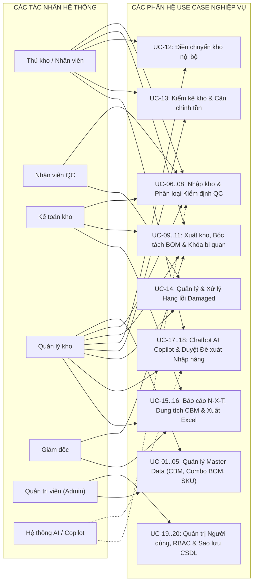
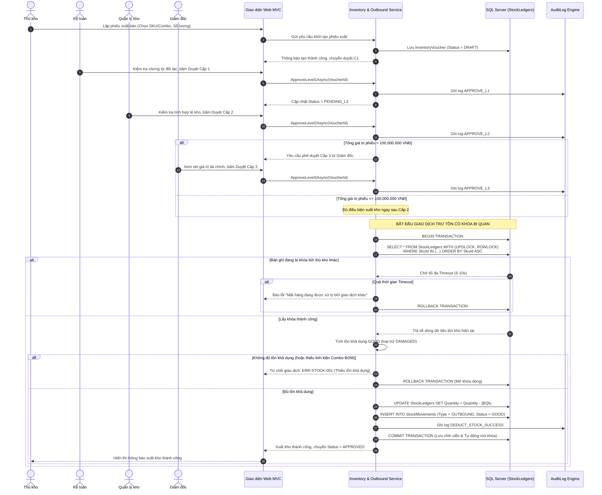
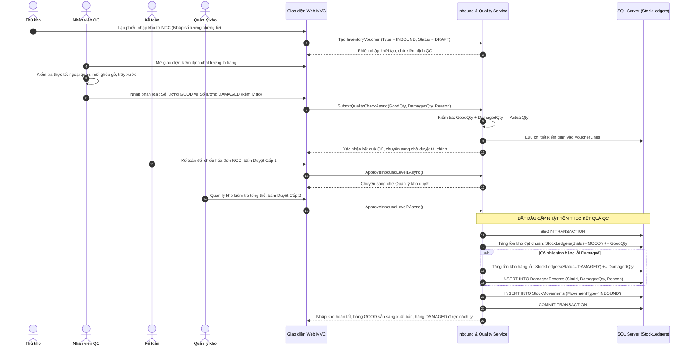
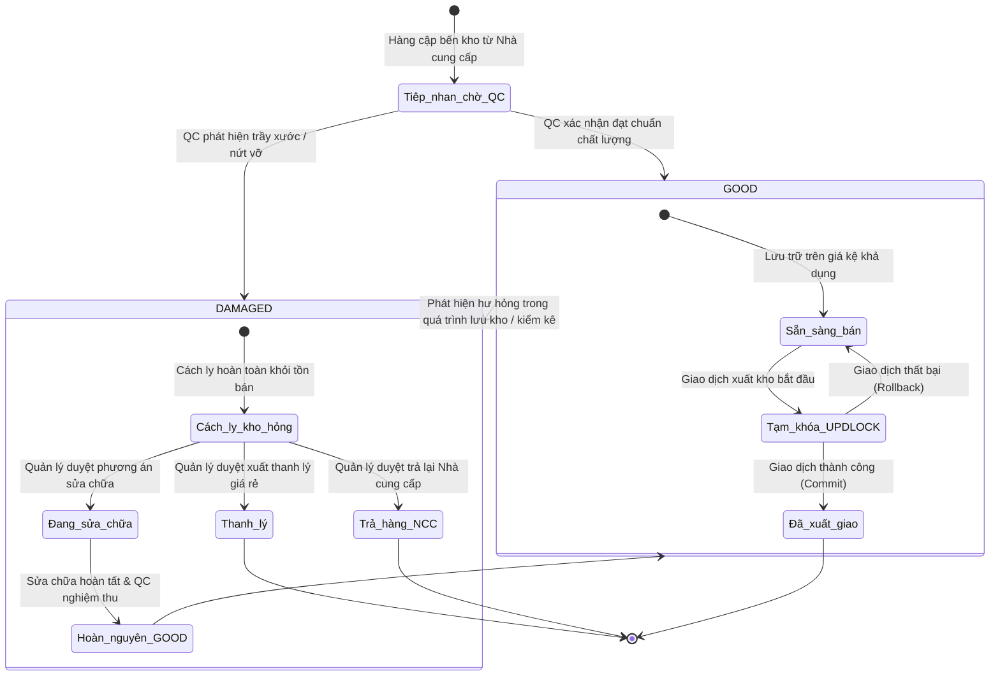

# HỆ THỐNG QUẢN LÝ KHO HÀNG NỘI THẤT TÍCH HỢP AI (FURNITURE WMS WITH INTEGRATED AI)
## TÀI LIỆU ĐẶC TẢ YÊU CẦU NGƯỜI DÙNG – USER REQUIREMENTS DOCUMENT (URD)
### Phiên bản: 2.0 (Hoàn thiện đồng bộ 100% theo Kiến trúc & Mã nguồn Thực tế Dự án)

---

> **Học phần:** Ứng dụng Trí tuệ Nhân tạo trong Phát triển Phần mềm (GenAI Software Development)  
> **Khoa:** Công nghệ Thông tin – Trường Đại học Công nghệ Thông tin & Truyền thông (ICTU) – Đại học Thái Nguyên  
> **Nhóm thực hiện:** Nhóm 7  
> **Thành viên đề tài:**  
> - **Nguyễn Đức Hiếu** (Trưởng nhóm – Kiến trúc hệ thống, Backend, AI Integration & Automated Testing)  
> - **Trần Minh Hiếu** (Thành viên – Database Design, Master Data, UI/UX & QA Testing)  
> **Thời gian thực hiện:** Năm học 2025 – 2026  
> **Trạng thái tài liệu:** Đã nghiệm thu thực tế • Đồng bộ 100% với Mã nguồn .NET 9 & 36/36 Automated xUnit Tests  

---

| Thông tin tài liệu | Giá trị chi tiết |
| :--- | :--- |
| **Mã tài liệu** | `URD-WMS-AI-FURNITURE-002` |
| **Tên tài liệu** | Đặc tả Yêu cầu Người dùng cho Hệ thống Quản lý Kho Hàng Nội thất Tích hợp AI |
| **Phiên bản** | v2.0 (Bản hoàn thiện theo mã nguồn dự án thực tế) |
| **Nền tảng ứng dụng** | Web Application (.NET 9 ASP.NET Core MVC, EF Core 9, SQL Server 2022, Local LLM Ollama) |
| **Phạm vi nghiệp vụ** | Master Data (Kích thước CBM, SKU biến thể, Combo BOM), Nhập kho & QC, Xuất kho & Khóa bi quan, Điều chuyển kho, Kiểm kê, Quản lý hàng lỗi Damaged, Phê duyệt 3 cấp, Báo cáo N-X-T, Trợ lý AI Copilot & Replenishment |
| **Đối tượng sử dụng** | Ban Giám đốc, Kế toán kho, Quản lý kho, Nhân viên Kiểm định chất lượng (QC), Thủ kho, Quản trị hệ thống (Admin) |

---

## 📌 MỤC LỤC

1. [Tổng quan đề tài & Giới thiệu bài toán](#1-tổng-quan-đề-tài--giới-thiệu-bài-toán)  
   1.1. [Bối cảnh nghiệp vụ ngành kho hàng nội thất](#11-bối-cảnh-nghiệp-vụ-ngành-kho-hàng-nội-thất)  
   1.2. [Tài liệu tham chiếu & Căn cứ kỹ thuật](#12-tài-liệu-tham-chiếu--căn-cứ-kỹ-thuật)  
   1.3. [Bảng thuật ngữ & Ký hiệu quy ước](#13-bảng-thuật-ngữ--ký-hiệu-quy-ước)  
2. [Mục tiêu và Phạm vi dự án](#2-mục-tiêu-và-phạm-vi-dự-án)  
   2.1. [Mục tiêu nghiệp vụ người dùng](#21-mục-tiêu-nghiệp-vụ-người-dùng)  
   2.2. [Phạm vi chức năng hệ thống](#22-phạm-vi-chức-năng-hệ-thống)  
   2.3. [Phạm vi ngoài hệ thống (Out of Scope)](#23-phạm-vi-ngoài-hệ-thống-out-of-scope)  
3. [Phân tích Stakeholder & Vai trò người dùng (Actors)](#3-phân-tích-stakeholder--vai-trò-người-dùng-actors)  
   3.1. [Danh mục Stakeholder](#31-danh-mục-stakeholder)  
   3.2. [Đặc tả 6 Actor người dùng & Actor Trí tuệ nhân tạo](#32-đặc-tả-6-actor-người-dùng--actor-trí-tuệ-nhân-tạo)  
   3.3. [Ma trận phân quyền sơ bộ theo vai trò](#33-ma-trận-phân-quyền-sơ-bộ-theo-vai-trò)  
4. [Khảo sát hiện trạng (AS-IS) & Mô hình chuyển đổi mục tiêu (TO-BE)](#4-khảo-sát-hiện-trạng-as-is--mô-hình-chuyển-đổi-mục-tiêu-to-be)  
   4.1. [Phân tích hiện trạng AS-IS (Quy trình thủ công bằng Excel)](#41-phân-tích-hiện-trạng-as-is-quy-trình-thủ-công-bằng-excel)  
   4.2. [Bảng đối chiếu Vấn đề - Hệ quả - Giải pháp TO-BE](#42-bảng-đối-chiếu-vấn-đề---hệ-quả---giải-pháp-to-be)  
   4.3. [Mô hình mục tiêu TO-BE tích hợp AI](#43-mô-hình-mục-tiêu-to-be-tích-hợp-ai)  
5. [Đặc tả Ca sử dụng người dùng (Use Cases)](#5-đặc-tả-ca-sử-dụng-người-dùng-use-cases)  
   5.1. [Danh mục Use Case tổng thể](#51-danh-mục-use-case-tổng-thể)  
   5.2. [Đặc tả chi tiết các Use Case trọng tâm](#52-đặc-tả-chi-tiết-các-use-case-trọng-tâm)  
6. [Quy tắc nghiệp vụ doanh nghiệp (Business Rules)](#6-quy-tắc-nghiệp-vụ-doanh-nghiệp-business-rules)  
7. [Yêu cầu chức năng người dùng (User Functional Requirements)](#7-yêu-cầu-chức-năng-người-dùng-user-functional-requirements)  
8. [Yêu cầu Trí tuệ nhân tạo (AI Functional Requirements)](#8-yêu-cầu-trí-tuệ-nhân-tạo-ai-functional-requirements)  
   8.1. [Năng lực Cảnh báo Tồn kho thấp (LOW_STOCK)](#81-năng-lực-cảnh-báo-tồn-kho-thấp-low_stock)  
   8.2. [Năng lực Phát hiện biến động bất thường (ANOMALY $\ge 20\%$)](#82-năng-lực-phát-hiện-biến-động-bất-thường-anomaly-ge-20)  
   8.3. [Năng lực Cảnh báo Nghẽn cổ chai cấu kiện Combo (BOTTLENECK)](#83-năng-lực-cảnh-báo-nghẽn-cổ-chai-cấu-kiện-combo-bottleneck)  
   8.4. [Năng lực Trợ lý AI Copilot tương tác tự nhiên & RAG Grounding](#84-năng-lực-trợ-lý-ai-copilot-tương-tác-tự-nhiên--rag-grounding)  
   8.5. [Nguyên tắc con người phê duyệt (Human-in-the-loop)](#85-nguyên-tắc-con-người-phê-duyệt-human-in-the-loop)  
9. [Yêu cầu phi chức năng người dùng (User Non-Functional Requirements)](#9-yêu-cầu-phi-chức-năng-người-dùng-user-non-functional-requirements)  
10. [Mô hình dữ liệu nghiệp vụ & Cấu trúc chứng từ](#10-mô-hình-dữ-liệu-nghiệp-vụ--cấu-trúc-chứng-từ)  
11. [Báo cáo & Kết xuất dữ liệu](#11-báo-cáo--kết-xuất-dữ-liệu)  
12. [Tiêu chí nghiệm thu người dùng (User Acceptance Criteria - UAC)](#12-tiêu-chí-nghiệm-thu-người-dùng-user-acceptance-criteria---uac)  
13. [Sơ đồ quy trình nghiệp vụ trực quan (Mermaid Diagrams)](#13-sơ-đồ-quy-trình-nghiệp-vụ-trực-quan-mermaid-diagrams)  
    13.1. [Sơ đồ Use Case tổng thể hệ thống WMS](#131-sơ-đồ-use-case-tổng-thể-hệ-thống-wms)  
    13.2. [Sequence Diagram: Quy trình Xuất kho & Khóa bi quan (Pessimistic Locking)](#132-sequence-diagram-quy-trình-xuất-kho--khóa-bi-quan-pessimistic-locking)  
    13.3. [Sequence Diagram: Quy trình Nhập kho & Kiểm định chất lượng QC](#133-sequence-diagram-quy-trình-nhập-kho--kiểm-định-chất-lượng-qc)  
    13.4. [Flowchart: Luồng xử lý AI Phân tích nhu cầu & Replenishment](#134-flowchart-luồng-xử-lý-ai-phân-tích-nhu-cầu--replenishment)  
    13.5. [State Diagram: Vòng đời trạng thái tồn kho hàng hóa nội thất](#135-state-diagram-vòng-đời-trạng-thái-tồn-kho-hàng-hóa-nội-thất)  

---

## 1. Tổng quan đề tài & Giới thiệu bài toán

### 1.1. Bối cảnh nghiệp vụ ngành kho hàng nội thất
Quản lý kho hàng nội thất (**Furniture Warehouse Management System - WMS**) là một bài toán vận hành logistics đặc thù với những thách thức vượt xa các hệ thống quản lý bán lẻ hay kho hàng tiêu dùng thông thường:
1. **Kích thước cồng kềnh, tính toán thể tích khối ($CBM$):** Các mặt hàng nội thất (bàn, ghế, giường, tủ, sofa) có thể tích chiếm chỗ rất lớn. Doanh nghiệp cần quản lý chi tiết kích thước 3 chiều $Dài \times Rộng \times Cao$ ($mm$) để tự động quy đổi ra thể tích $CBM$ ($m^3$), từ đó phân bổ sức chứa mặt sàn, kệ chứa và tính toán tải trọng xe tải vận chuyển.
2. **Sản phẩm lắp ráp theo bộ (Combo / BOM - Bill of Materials):** Nhiều sản phẩm nội thất bán thương mại dưới dạng bộ combo hoàn chỉnh (ví dụ: "Bộ bàn ăn Mango 6 ghế", "Bộ giường ngủ cao cấp kèm 2 táp đầu giường"). Bộ combo được cấu thành từ nhiều linh kiện/cấu kiện độc lập được nhập và đóng gói rời. Số lượng bộ combo có thể xuất bán không được lưu cứng mà phụ thuộc động vào số lượng linh kiện sẵn có tối thiểu.
3. **Phân loại chất lượng nghiêm ngặt (QC - Quality Control):** Quá trình vận chuyển, bốc dỡ đồ gỗ, da, kính rất dễ gây trầy xước, sứt mẻ. Ngay tại khâu tiếp nhận nhập kho, nhân viên QC bắt buộc phải kiểm định và phân luồng độc lập: số lượng đạt chuẩn (`GOOD`) được nhập vào tồn khả dụng xuất bán; số lượng trầy xước/lỗi (`DAMAGED`) phải cách ly hoàn toàn vào kho hàng hỏng để chờ sửa chữa hoặc thanh lý, tuyệt đối không được bán nhầm cho khách hàng.
4. **Nguy cơ bán âm & Xung đột giao dịch đồng thời:** Khi nhiều thủ kho hoặc nhân viên cùng thao tác tạo phiếu xuất trên cùng một mã SKU có số lượng tồn thấp, việc thiếu cơ chế khóa dữ liệu tức thời sẽ dẫn đến tình trạng xuất vượt tồn (xuất âm kho), gây vỡ hợp đồng giao dịch và tranh chấp pháp lý.
5. **Nhu cầu Trợ lý AI thông minh phục vụ vận hành:** Khối lượng mã hàng biến thể và chứng từ lớn đòi hỏi một trợ lý AI thông minh có khả năng trả lời ngôn ngữ tự nhiên tiếng Việt, tra cứu số liệu tồn kho chính xác theo thời gian thực (RAG Grounding), cảnh báo sớm biến động tiêu thụ đột biến và tự động đề xuất tạo phiếu nhập hàng dự phòng.

### 1.2. Tài liệu tham chiếu & Căn cứ kỹ thuật
1. **Chương trình đào tạo:** Học phần *Ứng dụng AI trong Phát triển Phần mềm (GenAI Software Development)*, Khoa CNTT - ICTU.
2. **Mô hình quy trình:** Mô hình Nhà máy Phát triển Phần mềm bằng AI (*AI Software Factory*) với 5 Agent chuyên trách (`agents/`).
3. **Tiêu chuẩn tài liệu:** URD v2.0 làm căn cứ trực tiếp xây dựng Đặc tả Yêu cầu Phần mềm (SRS v1.0 chuẩn IEEE 830).
4. **Mã nguồn và Kiểm thử:** Dự án triển khai trên nền tảng .NET 9.0 ASP.NET Core MVC, Entity Framework Core 9, Microsoft SQL Server 2022 (32 bảng) và Local LLM Ollama (`qwen2.5-coder:7b`), bao phủ bởi 36 ca kiểm thử tự động xUnit đạt 100% tỷ lệ vượt qua (*Passed*).

### 1.3. Bảng thuật ngữ & Ký hiệu quy ước

| Thuật ngữ / Ký hiệu | Tên tiếng Anh đầy đủ | Định nghĩa nghiệp vụ trong hệ thống |
| :--- | :--- | :--- |
| **WMS** | Warehouse Management System | Hệ thống phần mềm quản trị toàn diện hoạt động vận hành kho hàng. |
| **SKU** | Stock Keeping Unit | Mã định danh đơn vị hàng tồn kho duy nhất ứng với một tổ hợp biến thể (Mã gốc + Màu sắc + Chất liệu). |
| **CBM** | Cubic Meter ($m^3$) | Đơn vị thể tích mét khối: $CBM = (Dài \times Rộng \times Cao) / 10^9$ (kích thước tính theo mm). |
| **BOM** | Bill of Materials | Bảng định mức cấu kiện kỹ thuật cấu thành nên một sản phẩm Combo/Bộ. |
| **Combo Product** | Assembled / Set Product | Sản phẩm ghép bộ; tồn kho khả dụng được tính suy diễn từ tồn cấu kiện theo định mức BOM. |
| **QC** | Quality Control | Quy trình và nhân sự kiểm định chất lượng phân loại hàng Đạt (`GOOD`) và hàng Lỗi (`DAMAGED`). |
| **Damaged Stock** | Defective / Damaged Inventory | Tồn kho hàng lỗi/hỏng; hoàn toàn bị cách ly khỏi tồn kho khả dụng bán hàng thương mại. |
| **Pessimistic Locking** | Khóa bi quan CSDL | Cơ chế khóa cưỡng bức dòng dữ liệu tồn kho bằng T-SQL `WITH (UPDLOCK, ROWLOCK)` trong suốt giao dịch xuất/chuyển kho để loại trừ xung đột đồng thời. |
| **RBAC** | Role-Based Access Control | Kiểm soát truy cập và ủy quyền chức năng dựa trên vai trò người dùng trong tổ chức. |
| **RAG** | Retrieval-Augmented Generation | Kỹ thuật truy xuất dữ liệu CSDL kho thời gian thực nạp vào ngữ cảnh AI để chống ảo giác số liệu. |
| **Human-in-the-loop** | Con người giám sát quyết định | Nguyên tắc an toàn: AI chỉ sinh bản nháp (*DRAFT*) hoặc đề xuất (*PENDING_REVIEW*); chỉ con người có thẩm quyền mới được phê duyệt ghi dữ liệu chính thức. |

---

## 2. Mục tiêu và Phạm vi dự án

### 2.1. Mục tiêu nghiệp vụ người dùng
- **Số hóa và tự động hóa 100% quy trình vận hành kho:** Chuyển đổi toàn diện từ sổ sách, file Excel rời rạc sang nền tảng quản trị tập trung, tự động hóa cập nhật số dư kho sau mỗi chứng từ hợp lệ.
- **Tối ưu hóa dung tích chứa và phương tiện vận chuyển:** Tự động tính toán thể tích $CBM$ của từng SKU và cảnh báo khi tổng thể tích vượt ngưỡng an toàn của từng kho lưu trữ.
- **Quản lý chính xác sản phẩm Combo theo BOM:** Tự động tính tồn khả dụng của Combo theo linh kiện tối thiểu; tự động bóc tách linh kiện khi xuất bán.
- **Bảo đảm chất lượng hàng hóa xuất giao khách hàng:** Bắt buộc phân luồng kiểm định QC; ngăn chặn tuyệt đối việc xuất nhầm hàng lỗi (`DAMAGED`) cho khách hàng thương mại.
- **Loại trừ triệt để tình trạng bán âm và xung đột giao dịch:** Triển khai cơ chế Khóa bi quan ở tầng CSDL, bảo đảm an toàn dữ liệu khi có nhiều thủ kho thao tác song song.
- **Nâng cao năng suất bằng Trợ lý Trí tuệ nhân tạo:** Cung cấp Chatbot tra cứu thông tin kho bằng tiếng Việt tự nhiên; tự động phân tích dữ liệu 7 ngày vs 60 ngày để phát hiện bất thường nhu cầu $\ge 20\%$ và tự sinh phiếu nhập nháp khi tồn kho dưới định mức an toàn.
- **Bảo mật tuyệt đối bí mật kinh doanh:** Vận hành mô hình Local AI On-Premise 100%, bảo đảm không gửi dữ liệu giá vốn, đối tác ra máy chủ bên ngoài Internet.

### 2.2. Phạm vi chức năng hệ thống
Hệ thống bao phủ trọn vẹn 9 phân hệ chức năng:
1. **Phân hệ Dữ liệu gốc (Master Data):** Quản lý Danh mục Kho (kèm giới hạn CBM), Danh mục Nhà cung cấp, Danh mục Sản phẩm, Biến thể SKU (Màu sắc, Chất liệu, Kích thước 3 chiều, $CBM$, Đơn giá), Định mức linh kiện Combo BOM.
2. **Phân hệ Nhập kho (Inbound):** Lập phiếu nhập kho, tiếp nhận chứng từ đối tác, tích hợp bước kiểm định chất lượng QC phân loại số lượng `GOOD` và `DAMAGED`, quản lý duyệt phiếu.
3. **Phân hệ Xuất kho (Outbound):** Lập phiếu xuất bán / xuất công trình cho SKU đơn lẻ hoặc Combo, tự động bóc tách BOM, áp dụng Khóa bi quan T-SQL `UPDLOCK, ROWLOCK`, phân luồng phê duyệt 3 cấp độ.
4. **Phân hệ Điều chuyển kho nội bộ (Stock Transfer):** Quản lý điều chuyển hàng hóa giữa các kho nội bộ (Kho Tổng $\leftrightarrow$ Kho Chi nhánh, Kho Hàng lỗi), bảo đảm tính giao dịch nguyên tử 2 đầu.
5. **Phân hệ Quản lý Hàng lỗi (Damaged Stock):** Theo dõi số lượng hư hỏng, ghi nhận nguyên nhân, phân luồng xử lý: Sửa chữa hoàn nguyên về `GOOD`, Thanh lý hoặc Trả nhà cung cấp.
6. **Phân hệ Kiểm kê kho (Inventory Audit):** Lập phiếu kiểm kê định kỳ, ghi nhận số lượng đếm thực tế, tính chênh lệch Thừa/Thiếu so với sổ sách, sinh phiếu cân chỉnh kho có lưu vết kiểm toán.
7. **Phân hệ Phê duyệt đa cấp (Approval Workflow):** Kiểm soát rủi ro tài chính: Phiếu nhập và phiếu xuất $\le 100$ triệu VNĐ duyệt 2 cấp (Kế toán $\rightarrow$ Quản lý kho); Phiếu xuất $> 100$ triệu VNĐ bắt buộc Giám đốc phê duyệt cấp 3.
8. **Phân hệ Báo cáo & Thống kê (Reporting):** Báo cáo Nhập - Xuất - Tồn theo kỳ (phân tách hàng Đạt và hàng Lỗi), Báo cáo Thể tích CBM lưu kho, xuất dữ liệu chuẩn Excel (.xlsx) và PDF.
9. **Phân hệ Trí tuệ nhân tạo (AI Copilot & Replenishment):** Trợ lý tương tác tự nhiên tiếng Việt, RAG Grounding dữ liệu thời gian thực, quét phát hiện biến động nhu cầu $\ge 20\%$, cảnh báo nghẽn cổ chai cấu kiện Combo và tự động sinh bản nháp chứng từ.

### 2.3. Phạm vi ngoài hệ thống (Out of Scope)
- Hệ thống điều phối tuyến đường vận chuyển xe tải chặng cuối ngoài khuôn viên kho (Transportation Management System - TMS).
- Hệ thống hạch toán kế toán tài chính chuyên sâu toàn doanh nghiệp (tính lương, trích khấu hao tài sản cố định, quyết toán thuế nhà nước).
- Kênh bán lẻ trực tuyến (E-commerce B2C) hoặc tích hợp cổng thanh toán trực tiếp qua thẻ ngân hàng của người tiêu dùng.

---

## 3. Phân tích Stakeholder & Vai trò người dùng (Actors)

### 3.1. Danh mục Stakeholder
- **Ban Giám đốc Doanh nghiệp Nội thất:** Đòi hỏi số liệu tồn kho trung thực, báo cáo tổng thể tức thời, kiểm soát rủi ro các đơn hàng giá trị lớn ($> 100$ triệu VNĐ).
- **Bộ phận Quản lý Vận hành Kho:** Cần công cụ giám sát trực quan thể tích kho, phát hiện sớm nguy cơ thiếu hàng và nghẽn cấu kiện Combo.
- **Bộ phận Kế toán Kho:** Yêu cầu đối soát chứng từ nhập/xuất chặt chẽ, kiểm tra đơn giá, thuế, đối soát số dư cuối kỳ khớp đúng 100%.
- **Đội ngũ Kiểm định Chất lượng (QC):** Cần quy trình chuẩn để ghi nhận hàng lỗi, quy trách nhiệm và cách ly hàng hỏng ngay khi tiếp nhận.
- **Đội ngũ Thủ kho / Nhân viên Kho:** Cần giao diện tiếng Việt thân thiện, hỗ trợ thao tác nhanh, cảnh báo tức thời khi xuất vượt tồn.
- **Bộ phận Quản trị Hệ thống (IT/Admin):** Đòi hỏi tính ổn định, cơ chế sao lưu/phục hồi an toàn, quản lý tài khoản và giám sát toàn diện nhật ký kiểm toán.

### 3.2. Đặc tả 6 Actor người dùng & Actor Trí tuệ nhân tạo

Hệ thống thiết kế chuẩn hóa 6 vai trò người dùng (RBAC) và 1 tác nhân kỹ thuật:

```
┌────────────────────────────────────────────────────────────────────────┐
│                        ACTORS TRONG HỆ THỐNG WMS                       │
├───────────────────┬────────────────────────────────────────────────────┤
│ 1. Admin          │ Quản trị viên hệ thống (Toàn quyền cấu hình/backup)│
│ 2. Giám đốc       │ Director (Phê duyệt tài chính cấp cao > 100 triệu) │
│ 3. Quản lý kho    │ Warehouse Manager (Duyệt chứng từ kho & Gợi ý AI)  │
│ 4. Kế toán        │ Accountant (Đối chiếu chứng từ, duyệt tài chính C1)│
│ 5. QC             │ Quality Control (Kiểm định chất lượng GOOD/DAMAGED)│
│ 6. Thủ kho / NV   │ Warehouse Keeper / Staff (Lập phiếu, đếm kiểm kê)  │
├───────────────────┼────────────────────────────────────────────────────┤
│ 7. AI Copilot     │ Technical Actor (Trợ lý tra cứu, phân tích, đề xuất│
│                   │ chứng từ nháp có người giám sát)                   │
└───────────────────┴────────────────────────────────────────────────────┘
```

1. **Quản trị viên (Admin - `admin`):**
   - Quản trị tài khoản người dùng, phân quyền RBAC.
   - Cấu hình tham số hệ thống (ngưỡng tồn an toàn, ngưỡng cảnh báo CBM, ngưỡng phê duyệt Giám đốc, cấu hình URL Ollama).
   - Quản lý sao lưu (Backup) và phục hồi (Restore) dữ liệu toàn diện (JSON/SQL).
   - Giám sát toàn bộ nhật ký hệ thống (Audit Logs, Exception Logs).
2. **Giám đốc (Director - `giamdoc`):**
   - Xem bảng điều khiển điều hành (Executive Dashboard) và báo cáo tổng hợp giá trị tồn kho.
   - Thực hiện thẩm quyền phê duyệt Cấp 3 đối với các phiếu xuất kho có giá trị lớn hơn **100.000.000 VNĐ**.
3. **Quản lý kho (Warehouse Manager - `quanly`):**
   - Phê duyệt Cấp 2 cho toàn bộ phiếu nhập kho, phiếu xuất kho, phiếu chuyển kho.
   - Thẩm định và ra quyết định xử lý hàng lỗi (Damaged Stock): Sửa chữa, Thanh lý hoặc Trả NCC.
   - Phê duyệt kết quả kiểm kê và bút toán điều chỉnh tồn kho khi có chênh lệch.
   - Thẩm định và bấm nút **"Duyệt gợi ý AI"** để chuyển đề xuất phân tích thành chứng từ chính thức.
4. **Kế toán kho (Accountant - `ketoan`):**
   - Đối chiếu chứng từ nhà cung cấp và khách hàng với số liệu kiểm đếm thực tế.
   - Phê duyệt Cấp 1 trên các chứng từ nhập kho và xuất kho.
   - Xem và kết xuất báo cáo Nhập - Xuất - Tồn, báo cáo giá trị hàng hóa định kỳ ra Excel/PDF.
5. **Nhân viên Kiểm định chất lượng (QC - `qc`):**
   - Trực tiếp kiểm tra ngoại quan sản phẩm tại khu vực đệm tiếp nhận nhập kho.
   - Ghi nhận số lượng đạt chuẩn (`GOOD`) và số lượng trầy xước/lỗi kết cấu (`DAMAGED`), bắt buộc nhập lý do lỗi cụ thể.
6. **Thủ kho / Nhân viên (Warehouse Keeper / Staff - `thukho`):**
   - Khởi tạo các bản nháp phiếu nhập, phiếu xuất, phiếu chuyển kho.
   - Thực hiện thao tác kiểm đếm thực tế khi kiểm kê định kỳ và nhập số lượng vào hệ thống.
   - Tra cứu nhanh vị trí và số lượng tồn kho qua thanh công cụ tìm kiếm và Trợ lý AI Copilot.
7. **Hệ thống AI / Trợ lý Copilot (AI Engine):**
   - Tác nhân kỹ thuật chạy ngầm định kỳ (`AiMonitoringService`) quét dữ liệu kho để phát hiện bất thường nhu cầu $\ge 20\%$ và hàng dưới mức an toàn.
   - Trực tiếp hỗ trợ người dùng hội thoại tự nhiên, tra cứu số liệu kho thời gian thực và sinh mã lệnh tạo phiếu nháp theo chuẩn an toàn.

### 3.3. Ma trận phân quyền sơ bộ theo vai trò

| Chức năng nghiệp vụ | Thủ kho / NV | Nhân viên QC | Kế toán | Quản lý kho | Giám đốc | Quản trị viên |
| :--- | :---: | :---: | :---: | :---: | :---: | :---: |
| **Quản lý Danh mục (Master Data)** | Xem | Xem | Xem | Thêm / Sửa | Xem | Toàn quyền |
| **Lập phiếu Nhập/Xuất/Chuyển (DRAFT)** | **Tạo / Sửa** | - | Xem | Xem | Xem | Toàn quyền |
| **Kiểm định chất lượng QC (GOOD/DAMAGED)** | - | **Thực hiện** | Xem | Xem | Xem | Toàn quyền |
| **Phê duyệt Cấp 1 (Kế toán)** | - | - | **Duyệt C1** | - | - | Toàn quyền |
| **Phê duyệt Cấp 2 (Quản lý kho)** | - | - | - | **Duyệt C2** | - | Toàn quyền |
| **Phê duyệt Cấp 3 (Phiếu xuất $> 100$ tr)** | - | - | - | - | **Duyệt C3** | Toàn quyền |
| **Thực hiện Kiểm kê & Đếm thực tế** | **Thực hiện** | - | Xem | **Duyệt** | Xem | Toàn quyền |
| **Xử lý Hàng lỗi Damaged** | Đề xuất | Ghi nhận | Xem | **Duyệt** | Xem | Toàn quyền |
| **Duyệt đề xuất AI (Replenishment)** | Xem | - | Xem | **Duyệt** | Xem | Toàn quyền |
| **Báo cáo N-X-T, Báo cáo CBM** | Xem | Xem | **Xuất file** | **Xuất file** | Xem | Toàn quyền |
| **Sao lưu & Phục hồi CSDL** | - | - | - | - | - | **Toàn quyền** |

---

## 4. Khảo sát hiện trạng (AS-IS) & Mô hình chuyển đổi mục tiêu (TO-BE)

### 4.1. Phân tích hiện trạng AS-IS (Quy trình thủ công bằng Excel)
Trước khi triển khai dự án, hoạt động quản lý kho nội thất tại doanh nghiệp bộc lộ những hạn chế nghiêm trọng:
- **Quản lý dữ liệu phân mảnh:** Mỗi thủ kho và kế toán duy trì các file Excel riêng. Việc đồng bộ số liệu cuối tháng mất từ 3 đến 5 ngày, thường xuyên xảy ra lệch số dư đầu kỳ và cuối kỳ.
- **Bỏ quên kiểm tra thể tích CBM:** Nhân viên chỉ đếm số lượng chiếc/cái mà không tính được thể tích $m^3$, dẫn đến tình trạng kho bị quá tải cục bộ, hàng hóa xếp chồng gây nứt vỡ hoặc xe tải đến nhận hàng bị quá khổ không thể chở hết.
- **Sai lệch nghiêm trọng tồn kho Combo:** Do sản phẩm bộ (VD: Bàn ăn 6 ghế) được bán theo set nhưng nhập theo từng kiện lẻ, nhân viên kiểm tra thủ công thường xuất nhầm khi mặt bàn còn nhưng chân bàn hoặc ghế đã hết, dẫn đến khiếu nại gay gắt từ khách hàng.
- **Trộn lẫn hàng lỗi vào hàng tốt:** Hàng hóa bị trầy xước trong quá trình bốc xếp không được phân loại rõ ràng trong sổ sách, bị để lẫn vào khu vực hàng đạt chuẩn và vô tình xuất giao cho khách hàng mới.
- **Xuất âm kho do tranh chấp đồng thời:** Hai nhân viên bán hàng cùng nhìn thấy số tồn trên file Excel là 5 chiếc và đồng thời xuất bán cho 2 khách khác nhau, dẫn đến tồn thực tế bị âm.
- **Phụ thuộc vào cảm tính khi đặt hàng:** Việc quyết định nhập thêm hàng hóa hoàn toàn dựa vào kinh nghiệm thủ công, không phân tích được xu hướng biến động tiêu thụ 7 ngày so với 60 ngày.

### 4.2. Bảng đối chiếu Vấn đề - Hệ quả - Giải pháp TO-BE

| STT | Vấn đề hiện trạng (AS-IS) | Hậu quả thực tế phát sinh | Giải pháp hệ thống mục tiêu (TO-BE) |
| :---: | :--- | :--- | :--- |
| **1** | Nhập liệu thủ công nhiều lần trên Excel | Sai lệch số liệu, lãng phí 40% thời gian hành chính | CSDL SQL Server 32 bảng chuẩn 3NF, tự động cập nhật tồn tức thời sau giao dịch. |
| **2** | Không quản lý kích thước và thể tích | Kho quá tải thể tích, xe tải không xếp vừa hàng | Tự động tính $CBM = (D \times R \times C) / 10^9$; cảnh báo vượt sức chứa kho. |
| **3** | Kiểm tra thủ công linh kiện hàng Combo | Xuất thiếu chân bàn/ghế, vỡ hợp đồng đơn hàng | Định nghĩa BOM; tồn Combo tự động suy diễn theo linh kiện tối thiểu; tự động bóc tách khi xuất. |
| **4** | Hàng trầy xước để lẫn hàng đạt chuẩn | Giao nhầm hàng lỗi cho khách, mất uy tín | Quy trình QC bắt buộc; phân tách rạch ròi trạng thái `GOOD` và `DAMAGED`; cách ly kho lỗi. |
| **5** | Xuất vượt tồn khi nhiều người thao tác | Bán âm kho, tồn kho ảo trên hệ thống | Cơ chế Khóa bi quan (*Pessimistic Locking*) với `UPDLOCK, ROWLOCK` ở cấp CSDL. |
| **6** | Duyệt chi và xuất hàng lỏng lẻo | Thất thoát tài chính với các đơn hàng giá trị lớn | Workflow phê duyệt 3 cấp độ; đơn hàng $> 100$ triệu bắt buộc Giám đốc duyệt. |
| **7** | Dự báo đặt hàng theo cảm tính | Thiếu hàng bán chạy, ứ đọng vốn hàng tồn chậm | AI Engine phân tích 7 ngày vs 60 ngày; cảnh báo biến động $\ge 20\%$ và tự sinh phiếu nhập nháp. |

### 4.3. Mô hình mục tiêu TO-BE tích hợp AI
Trong mô hình TO-BE, toàn bộ dòng chảy thông tin và vật chất được kết nối liền mạch:
1. **Tiếp nhận & QC:** Hàng về kho $\rightarrow$ Thủ kho nhập số chứng từ $\rightarrow$ QC kiểm tra phân loại `GOOD`/`DAMAGED` $\rightarrow$ Kế toán duyệt C1 $\rightarrow$ Quản lý duyệt C2 $\rightarrow$ Tồn kho tự động cập nhật tăng tương ứng.
2. **Xuất kho & Khóa bi quan:** Thủ kho tạo phiếu xuất $\rightarrow$ Kế toán duyệt C1 $\rightarrow$ Quản lý duyệt C2 (nếu $>100$ triệu chuyển Giám đốc duyệt C3) $\rightarrow$ Hệ thống áp dụng khóa `UPDLOCK, ROWLOCK` $\rightarrow$ Kiểm tra tồn khả dụng `GOOD` $\rightarrow$ Bóc tách linh kiện BOM $\rightarrow$ Trừ tồn $\rightarrow$ Mở khóa và lưu Audit Log.
3. **Giám sát thông minh AI:** Tiến trình `AiMonitoringService` quét liên tục $\rightarrow$ Phát hiện biến động $\ge 20\%$ hoặc tồn $< MinStock$ $\rightarrow$ Tạo đề xuất `PENDING_REVIEW` $\rightarrow$ Quản lý kho bấm duyệt $\rightarrow$ Tự động chuyển thành Phiếu nhập nháp.
4. **Trợ lý AI Copilot:** Người dùng gõ câu lệnh tiếng Việt $\rightarrow$ Trợ lý nạp snapshot CSDL thực tế $\rightarrow$ Giải đáp chính xác hoặc sinh mã lệnh tạo phiếu nháp $\rightarrow$ Backend kiểm tra rào chắn an toàn và lưu vào CSDL.

---

## 5. Đặc tả Ca sử dụng người dùng (Use Cases)

### 5.1. Danh mục Use Case tổng thể

| Nhóm chức năng | Mã UC | Tên Use Case | Actor chính | Mục tiêu nghiệp vụ |
| :--- | :--- | :--- | :--- | :--- |
| **Master Data** | **UC-01** | Quản lý Danh mục Hàng hóa | Quản lý / Admin | Khai báo mã hàng, tên hàng, đơn vị tính, mức tồn tối thiểu. |
| | **UC-02** | Quản lý Kích thước & Tính CBM | Quản lý / Thủ kho | Nhập Dài, Rộng, Cao (mm) $\rightarrow$ Tự động tính CBM ($m^3$). |
| | **UC-03** | Quản lý Biến thể SKU | Quản lý kho | Tạo biến thể theo Màu sắc, Chất liệu, Đơn giá. |
| | **UC-04** | Quản lý Hàng Combo & Định mức BOM | Quản lý kho | Thiết lập định mức linh kiện cấu thành nên bộ combo. |
| | **UC-05** | Quản lý Nhà cung cấp & Kho hàng | Quản lý / Admin | Quản lý đối tác và kho bãi kèm sức chứa CBM tối đa. |
| **Inbound & QC** | **UC-06** | Lập Phiếu nhập kho | Thủ kho / Nhân viên | Ghi nhận chứng từ nhập hàng từ nhà cung cấp. |
| | **UC-07** | Kiểm định Chất lượng (QC) | Nhân viên QC | Phân tách số lượng thực nhận thành hàng GOOD và DAMAGED. |
| | **UC-08** | Phê duyệt Phiếu nhập kho | Kế toán $\rightarrow$ Quản lý | Duyệt 2 cấp trước khi tăng số dư tồn kho chính thức. |
| **Outbound** | **UC-09** | Lập Phiếu xuất kho | Thủ kho / Nhân viên | Lập chứng từ xuất bán SKU lẻ hoặc Combo. |
| | **UC-10** | Phê duyệt Phiếu xuất đa cấp | Kế toán $\rightarrow$ Quản lý $\rightarrow$ Giám đốc | Duyệt 2 cấp ($\le 100$ tr) hoặc 3 cấp ($> 100$ tr) theo giá trị. |
| | **UC-11** | Xuất kho & Khóa bi quan | Hệ thống (Tự động) | Khóa `UPDLOCK`, kiểm tra tồn khả dụng, bóc tách BOM, trừ tồn. |
| **Inventory** | **UC-12** | Điều chuyển kho nội bộ | Thủ kho / Quản lý | Luân chuyển hàng hóa giữa các kho với tính giao dịch nguyên tử. |
| | **UC-13** | Kiểm kê kho định kỳ | Thủ kho / Quản lý | Đếm thực tế, tính tỷ lệ chênh lệch, lập bút toán cân chỉnh tồn. |
| | **UC-14** | Xử lý Hàng lỗi (Damaged Stock) | Quản lý kho | Duyệt phương án Sửa chữa, Thanh lý hoặc Trả NCC. |
| **Reporting** | **UC-15** | Xem Báo cáo Nhập - Xuất - Tồn | Kế toán / Quản lý | Đối chiếu Tồn đầu + Nhập - Xuất = Tồn cuối; xuất Excel/PDF. |
| | **UC-16** | Xem Báo cáo Dung tích CBM Kho | Quản lý / Giám đốc | Giám sát mức độ lấp đầy thể tích $m^3$ của từng kho. |
| **AI Copilot** | **UC-17** | Chat Tra cứu & Tương tác AI | Toàn bộ người dùng | Tra cứu tồn, hỏi đáp vận hành, tạo bản nháp bằng giọng văn tự nhiên. |
| | **UC-18** | Duyệt Đề xuất Nhập hàng AI | Quản lý kho | Thẩm định cảnh báo biến động 20% và duyệt tạo đơn nhập nháp. |
| **System Admin**| **UC-19** | Quản trị Người dùng & Phân quyền | Quản trị viên (Admin) | Tạo tài khoản, gán vai trò RBAC, đặt lại mật khẩu. |
| | **UC-20** | Sao lưu & Phục hồi CSDL | Quản trị viên (Admin) | Tạo bản snapshot JSON/SQL và phục hồi hệ thống khi có sự cố. |

### 5.2. Đặc tả chi tiết các Use Case trọng tâm

#### UC-07: Kiểm định Chất lượng (QC) khi Nhập kho
- **Actor chính:** Nhân viên QC (`qc`).
- **Tiền điều kiện:** Phiếu nhập kho đã được tạo ở trạng thái `DRAFT` và hàng hóa vật lý đã cập bến khu vực nhận hàng.
- **Luồng sự kiện chính (Happy Path):**
  1. Nhân viên QC mở danh sách phiếu nhập chờ kiểm định chất lượng.
  2. Nhân viên tiến hành kiểm tra ngoại quan từng kiện hàng của từng dòng sản phẩm.
  3. Ghi nhận số lượng đạt chuẩn vào ô `Số lượng Tốt (GOOD)`.
  4. Nếu phát hiện trầy xước, nứt vỡ, ghi nhận vào ô `Số lượng Lỗi (DAMAGED)` và bắt buộc nhập lý do chi tiết (VD: "Trầy xước mặt gỗ sồi do va quẹt trong container").
  5. Hệ thống kiểm tra ràng buộc: $Số\_lượng\_Tốt + Số\_lượng\_Lỗi = Số\_lượng\_Thực\_nhận$.
  6. Bấm "Lưu kết quả QC". Trạng thái phiếu chuyển sang chờ Kế toán duyệt Cấp 1.
- **Ngoại lệ:**
  - Nếu tổng số lượng Tốt và Lỗi không khớp với số lượng thực nhận, hệ thống báo lỗi và chặn không cho lưu.
- **Hậu điều kiện:** Bản ghi kiểm định được xác lập; hàng `DAMAGED` được đánh dấu để khi duyệt sẽ tự động phân loại cách ly khỏi tồn bán hàng.

#### UC-11: Xuất kho & Khóa bi quan (Pessimistic Locking)
- **Actor chính:** Hệ thống (tự động kích hoạt khi phiếu xuất hoàn tất phê duyệt).
- **Tiền điều kiện:** Phiếu xuất đã nhận đủ phê duyệt (Cấp 2 nếu $\le 100$ tr; Cấp 3 nếu $> 100$ tr).
- **Luồng sự kiện chính:**
  1. Hệ thống khởi tạo một Giao dịch CSDL (`DbTransaction`).
  2. Trích xuất danh sách tất cả mã SKU liên quan (nếu là Combo, tự động bóc tách thành các SKU linh kiện theo định mức BOM).
  3. Sắp xếp danh sách mã SKU theo thứ tự bảng chữ cái tăng dần (`ORDER BY SkuId ASC`) để chống Deadlock.
  4. Thực thi câu lệnh truy vấn cưỡng bức khóa bi quan:
     ```sql
     SELECT * FROM StockLedgers WITH (UPDLOCK, ROWLOCK) 
     WHERE SkuId IN (...) AND WarehouseId = @WarehouseId AND Status = 'GOOD'
     ORDER BY SkuId ASC
     ```
  5. Hệ thống tính toán tồn khả dụng: Chỉ tính tồn có trạng thái `GOOD`.
  6. Kiểm tra số lượng tồn:
     - Nếu là SKU đơn lẻ: $Tồn\_khả\_dụng \ge Số\_lượng\_xuất$.
     - Nếu là Combo: Mọi linh kiện đều phải thỏa mãn $Tồn\_khả\_dụng_i \ge Số\_lượng\_Combo \times Định\_mức_i$.
  7. Trừ số lượng tồn trực tiếp trên dòng dữ liệu `StockLedgers`.
  8. Ghi nhận bản ghi lịch sử biến động kho (`StockMovements`) với loại `OUTBOUND`.
  9. Ghi nhận nhật ký kiểm toán (`AuditLogs`).
  10. Thực thi `CommitTransaction` để lưu vĩnh viễn và tự động giải phóng khóa dòng.
  11. Chuyển trạng thái phiếu xuất sang `APPROVED` (Đã xuất kho).
- **Ngoại lệ:**
  - Nếu thiếu tồn bất kỳ linh kiện nào: Toàn bộ giao dịch bị `RollbackTransaction`, không trừ một phần, trả thông báo lỗi `ERR-STOCK-001` hoặc `ERR-STOCK-002`.
  - Nếu bản ghi đang bị khóa bởi thủ kho khác quá thời gian chờ (Timeout 5-10s): Trả thông báo hệ thống đang bận, yêu cầu thử lại sau.

#### UC-18: Duyệt Đề xuất Nhập hàng AI (Smart Replenishment)
- **Actor chính:** Quản lý kho (`quanly`).
- **Tiền điều kiện:** Hệ thống đã chạy phân tích ngầm và tạo bản ghi đề xuất ở bảng `AiSuggestions` với trạng thái `PENDING_REVIEW`.
- **Luồng sự kiện chính:**
  1. Quản lý kho truy cập chức năng **Gợi ý Nhập hàng & Cảnh báo AI** (`/Replenishment`).
  2. Hệ thống hiển thị danh sách thẻ phân loại: Cảnh báo tồn thấp, Cảnh báo biến động nhu cầu 20%, Cảnh báo nghẽn cấu kiện Combo.
  3. Quản lý bấm xem chi tiết căn cứ tính toán (MinStock, tồn thực tế, nhu cầu trung bình 7 ngày vs 60 ngày, % biến động).
  4. Quản lý có thể điều chỉnh số lượng đề xuất nhập nếu cần thiết.
  5. Quản lý bấm nút **"Duyệt gợi ý AI"**.
  6. Hệ thống tự động khởi tạo một Phiếu nhập kho bản nháp (`InventoryVoucher` type `INBOUND`, status `DRAFT`), gắn thông tin mặt hàng, số lượng đề xuất và ghi chú nguồn gốc AI.
  7. Cập nhật trạng thái đề xuất AI thành `APPROVED`.
  8. Hệ thống điều hướng trực tiếp đến màn hình chi tiết phiếu nhập nháp vừa tạo để tiến hành quy trình duyệt kho chuẩn.

---

## 6. Quy tắc nghiệp vụ doanh nghiệp (Business Rules)

| Mã luật | Tên quy tắc nghiệp vụ | Nội dung chi tiết quy tắc |
| :--- | :--- | :--- |
| **BR-01** | **Công thức tính CBM** | Thể tích của từng mã SKU bắt buộc tính tự động theo công thức: $$CBM = \frac{Dài (mm) \times Rộng (mm) \times Cao (mm)}{1.000.000.000}$$ Cả 3 chiều kích thước phải là số nguyên dương $> 0$. Không cho phép nhập kích thước âm hoặc bằng 0. |
| **BR-02** | **Tồn khả dụng Combo (Derived Stock)** | Tồn kho của hàng Combo là tồn suy diễn động, tuyệt đối **không lưu cứng** vào bảng tồn kho. Công thức: $$Available(Combo) = \min_{i} \left\lfloor \frac{Available(Component_i)}{QuantityPerSet_i} \right\rfloor$$ |
| **BR-03** | **Bóc tách BOM khi Xuất Combo** | Khi xuất 1 bộ Combo, hệ thống bắt buộc tự động phân rã và trừ tồn từng linh kiện theo định mức cấu thành. Thiếu bất kỳ 1 linh kiện nào cũng bị từ chối toàn bộ đơn hàng. |
| **BR-04** | **Phân tách Trạng thái Tồn kho** | Tồn kho phân định tuyệt đối giữa hàng Đạt chuẩn (`GOOD`) và hàng Lỗi/Hỏng (`DAMAGED`). Hàng `DAMAGED` không bao giờ được tính vào tồn khả dụng xuất bán thương mại. |
| **BR-05** | **Khóa bi quan chống xuất âm** | Mọi thao tác xuất kho hoặc trừ tồn bắt buộc phải áp dụng khóa cưỡng bức dòng dữ liệu `WITH (UPDLOCK, ROWLOCK)` trong cùng một Transaction CSDL; sắp xếp khóa theo `SkuId ASC` để chống Deadlock. |
| **BR-06** | **Phân luồng Phê duyệt 3 cấp độ** | - Phiếu nhập và Phiếu xuất $\le 100.000.000$ VNĐ: Bắt buộc đủ 2 cấp duyệt (Cấp 1: Kế toán $\rightarrow$ Cấp 2: Quản lý kho).<br>- Phiếu xuất $> 100.000.000$ VNĐ: Bắt buộc phải có thêm Cấp 3 do Giám đốc phê duyệt. |
| **BR-07** | **Ngưỡng Biến động Nhu cầu AI** | AI phát hiện và kích hoạt cảnh báo biến động bất thường khi tốc độ xuất bán trung bình 7 ngày gần nhất chênh lệch **$\ge 20\%$** so với trung bình 60 ngày: $$|\% Biến\_động| = \frac{|TB\_7\_ngày - TB\_60\_ngày|}{TB\_60\_ngày} \ge 0.20$$ |
| **BR-08** | **Nguyên tắc Human-in-the-loop** | AI Engine hoàn toàn **KHÔNG CÓ QUYỀN ghi đè** trực tiếp số dư tồn kho hoặc phê duyệt chứng từ. AI chỉ được phép sinh bản nháp (`DRAFT`) hoặc đề xuất (`PENDING_REVIEW`). Mọi cập nhật số dư kho bắt buộc phải do con người phê duyệt. |
| **BR-09** | **Bảo toàn Số dư (Audit-first)** | Số dư kho cuối kỳ luôn tuân thủ nguyên tắc cân bằng kế toán: $$Tồn\_cuối = Tồn\_đầu + Nhập - Xuất + Nhận\_chuyển - Xuất\_chuyển \pm Điều\_chỉnh$$ Mọi biến động đều phải lưu vết vào bảng `AuditLogs` tối thiểu 5 năm. |
| **BR-10** | **Ngưỡng Chênh lệch Kiểm kê 5%** | Trong quá trình kiểm kê, nếu tỷ lệ chênh lệch giữa số lượng đếm thực tế và số liệu hệ thống vượt quá $5\%$, hệ thống bắt buộc phải lập Phiếu điều chỉnh tồn kho và chuyển Quản lý duyệt trước khi cân chỉnh. |

---

## 7. Yêu cầu chức năng người dùng (User Functional Requirements)

| Mã yêu cầu | Phân hệ nghiệp vụ | Đặc tả yêu cầu chức năng người dùng |
| :--- | :--- | :--- |
| **REQ-F-01** | Master Data | Cho phép quản lý danh mục sản phẩm, biến thể SKU kèm hình ảnh, đơn giá và định mức tồn tối thiểu ($MinStock$). |
| **REQ-F-02** | Master Data | Tự động tính $CBM$ khi nhập Dài, Rộng, Cao. Chặn lưu nếu thiếu một trong ba kích thước. |
| **REQ-F-03** | Master Data | Cho phép định nghĩa sản phẩm Combo và bảng định mức linh kiện cấu thành ($BOM$). |
| **REQ-F-04** | Master Data | Quản lý danh mục Kho bãi kèm sức chứa thể tích tối đa ($MaxCapacityCbm$). |
| **REQ-F-05** | Master Data | Quản lý danh mục Đối tác Nhà cung cấp và Khách hàng kèm mã số thuế, địa chỉ, số điện thoại. |
| **REQ-F-06** | Inbound | Cho phép lập Phiếu nhập kho từ Nhà cung cấp ở trạng thái Bản nháp ($DRAFT$). |
| **REQ-F-07** | Inbound & QC | Hỗ trợ giao diện kiểm định QC: phân tách số lượng thực nhận thành hàng `GOOD` và hàng `DAMAGED` kèm lý do lỗi. |
| **REQ-F-08** | Inbound | Phân quyền phê duyệt phiếu nhập 2 cấp (Kế toán duyệt Cấp 1 $\rightarrow$ Quản lý kho duyệt Cấp 2). |
| **REQ-F-09** | Outbound | Cho phép lập Phiếu xuất kho bán hàng, xuất dự án công trình cho SKU lẻ hoặc Combo. |
| **REQ-F-10** | Outbound | Tự động bóc tách linh kiện Combo BOM khi xuất và kiểm tra tính sẵn sàng của tất cả linh kiện. |
| **REQ-F-11** | Outbound | Áp dụng cơ chế Khóa bi quan chống xuất âm kho; từ chối giao dịch nếu không đủ tồn khả dụng `GOOD`. |
| **REQ-F-12** | Outbound | Tự động kiểm tra giá trị phiếu: nếu $> 100$ triệu VNĐ, bắt buộc chuyển Giám đốc phê duyệt cấp 3. |
| **REQ-F-13** | Stock Transfer | Quản lý điều chuyển hàng hóa giữa các kho nội bộ với tính giao dịch nguyên tử 2 đầu (Atomic Transaction). |
| **REQ-F-14** | Inventory Audit | Hỗ trợ tạo phiếu kiểm kê theo kho, nhập số lượng đếm thực tế, tính chênh lệch Thừa/Thiếu. |
| **REQ-F-15** | Inventory Audit | Tự động sinh bút toán cân chỉnh kho khi kết quả kiểm kê được Quản lý kho phê duyệt. |
| **REQ-F-16** | Damaged Stock | Quản lý tồn kho hàng lỗi riêng biệt; hỗ trợ phê duyệt phương án: Sửa chữa, Thanh lý, Trả NCC. |
| **REQ-F-17** | Reporting | Cung cấp Báo cáo Nhập - Xuất - Tồn theo kỳ, hỗ trợ lọc theo kho, mã hàng, nhà cung cấp. |
| **REQ-F-18** | Reporting | Cung cấp Báo cáo Thể tích lưu kho CBM và phát hiện các kho có nguy cơ quá tải sức chứa. |
| **REQ-F-19** | Reporting | Hỗ trợ kết xuất báo cáo ra định dạng file Excel (.xlsx) và file PDF chuẩn hóa. |
| **REQ-F-20** | System Admin | Quản trị tài khoản, gán vai trò RBAC trong 6 nhóm quyền, hỗ trợ kích hoạt/khóa tài khoản. |
| **REQ-F-21** | System Admin | Hỗ trợ Sao lưu toàn bộ 32 bảng CSDL ra file JSON/SQL và khôi phục khi có sự cố. |
| **REQ-F-22** | Audit Trail | Ghi nhận tự động nhật ký kiểm toán mọi hành động Thêm/Sửa/Xóa/Duyệt, lưu vết tối thiểu 5 năm. |

---

## 8. Yêu cầu Trí tuệ nhân tạo (AI Functional Requirements)

### 8.1. Năng lực Cảnh báo Tồn kho thấp (LOW_STOCK)
- **Mã yêu cầu:** `REQ-AI-01`.
- **Mô tả:** Hệ thống tự động so sánh số lượng tồn khả dụng (chỉ tính hàng `GOOD`) của từng mã SKU với chỉ số $MinStock$ đã cấu hình tại Product Model.
- **Xử lý:** Khi $Stock_{GOOD} < MinStock$, hệ thống tự động sinh bản ghi đề xuất nhập bổ sung:
  $$SuggestedQty = \max(MinStock - Stock_{GOOD}, MinStock)$$
- **Thông báo:** Hiển thị trực quan trên giao diện Replenishment và gửi email cảnh báo tự động cho Quản lý kho nếu được bật cấu hình.

### 8.2. Năng lực Phát hiện biến động bất thường (ANOMALY $\ge 20\%$)
- **Mã yêu cầu:** `REQ-AI-02`.
- **Mô tả:** Hệ thống phân tích lịch sử xuất kho của các mặt hàng đạt chuẩn `GOOD` trong 60 ngày gần nhất.
- **Công thức tính toán:**
  - Nhu cầu trung bình ngày trong 60 ngày: $AvgDaily_{60} = \sum Qty_{60} / 60$.
  - Nhu cầu trung bình ngày trong 7 ngày gần nhất: $AvgDaily_{7} = \sum Qty_{7} / 7$.
  - Tỷ lệ sai lệch: $Diff = (AvgDaily_{7} - AvgDaily_{60}) / AvgDaily_{60}$.
- **Ngưỡng kích hoạt:** Khi $|Diff| \ge 0.20$ (Tăng hoặc giảm từ $20\%$ trở lên), hệ thống xác định đây là biến động nhu cầu bất thường.
- **Đề xuất dự phòng:** Tự động tính lượng hàng cần bù đắp cho nhu cầu 30 ngày tiếp theo để tránh đứt gãy nguồn cung.

### 8.3. Năng lực Cảnh báo Nghẽn cổ chai cấu kiện Combo (BOTTLENECK)
- **Mã yêu cầu:** `REQ-AI-03`.
- **Mô tả:** Quét toàn bộ danh mục Combo Products và định mức linh kiện BOM liên kết.
- **Xác định điểm nghẽn:** Với từng Combo, tìm linh kiện có tỷ số $Stock_i / QtyPerSet_i$ nhỏ nhất. Linh kiện này là nguyên nhân chính kìm hãm số lượng bộ Combo có thể lắp ráp.
- **Cảnh báo:** Nếu số bộ lắp ráp tối đa nhỏ hơn mức tồn an toàn của Combo ($MinStock_{Combo}$), hệ thống phát cảnh báo "Linh kiện cổ chai", đề xuất ưu tiên đặt hàng chính xác linh kiện đang thiếu hụt.

### 8.4. Năng lực Trợ lý AI Copilot tương tác tự nhiên & RAG Grounding
- **Mã yêu cầu:** `REQ-AI-04`.
- **Mô tả:** Tích hợp hộp hội thoại AI Copilot tại thanh điều hướng hệ thống, hỗ trợ hỏi đáp nghiệp vụ kho bằng tiếng Việt tự nhiên.
- **Cơ chế RAG Grounding thời gian thực (`AiChatGroundingService`):**
  - Trước khi gửi câu hỏi đến mô hình LLM Ollama, hệ thống tự động truy xuất snapshot dữ liệu thực tế: Tổng số SKU, Tổng tồn `GOOD`, Tổng tồn `DAMAGED`, Thống kê chi tiết số lượng phiếu Nhập/Xuất/Chuyển theo từng trạng thái (`APPROVED`, `PENDING`, `REJECTED`, `DRAFT`).
  - Gắn snapshot dữ liệu vào System Prompt để LLM trả lời chuẩn xác 100%, loại trừ hoàn toàn ảo giác số liệu.
- **Cơ chế Rào chắn mã lệnh (Guardrails & Action Function Calling):**
  - Khi người dùng yêu cầu tạo chứng từ (VD: "Tạo giúp tôi đơn nhập 20 bàn ăn"), AI sinh mã lệnh chuẩn hóa:
    `[ACTION: CREATE_DRAFT_INBOUND: {"counterparty": "...", "sku": "...", "quantity": 20}]`
  - Backend phân tích bằng Regex, tự động khởi tạo bản ghi `InventoryVoucher` thật vào SQL Server ở trạng thái `DRAFT` với mã phiếu thực tế (VD: `PN-20261029040012`), tuyệt đối không để AI tự bịa mã phiếu ảo.

### 8.5. Nguyên tắc con người phê duyệt (Human-in-the-loop)
- **Mã yêu cầu:** `REQ-AI-05`.
- **Nguyên tắc cốt lõi:**
  1. AI không có thẩm quyền trực tiếp ghi nhận tăng/giảm tồn kho.
  2. Mọi phiếu do AI sinh ra chỉ dừng lại ở trạng thái **Bản nháp (`DRAFT`)**.
  3. Mọi đề xuất phân tích của AI dừng lại ở trạng thái **Chờ xem xét (`PENDING_REVIEW`)**.
  4. Chỉ khi Quản lý kho, Kế toán và Giám đốc kiểm tra thông tin và bấm nút duyệt chính thức trên giao diện Web, các biến động kho mới được ghi nhận vào CSDL.

---

## 9. Yêu cầu phi chức năng người dùng (User Non-Functional Requirements)

| Mã yêu cầu | Nhóm yêu cầu | Nội dung đặc tả phi chức năng |
| :--- | :--- | :--- |
| **REQ-NF-01** | **Bảo mật & Danh tính** | Sử dụng ASP.NET Core Identity; mật khẩu băm theo thuật toán PBKDF2; chống tấn công CSRF qua token Anti-Forgery trên 100% biểu mẫu. |
| **REQ-NF-02** | **Bảo mật AI On-Premise** | Mô hình AI chạy Local 100% qua Ollama trên máy chủ nội bộ. Không gửi dữ liệu kinh doanh, giá vốn và danh sách nhà cung cấp ra bên ngoài. |
| **REQ-NF-03** | **Toàn vẹn Dữ liệu (Locking)** | Triển khai Khóa bi quan ở cấp CSDL với T-SQL `WITH (UPDLOCK, ROWLOCK)` trong transaction; đảm bảo 0% khả năng xảy ra xuất âm kho. |
| **REQ-NF-04** | **Lưu vết Kiểm toán (Audit)** | Mọi giao dịch thay đổi dữ liệu kho được ghi log chi tiết (người dùng, thời gian, IP, giá trị trước/sau); lưu trữ tối thiểu 5 năm phục vụ thanh tra. |
| **REQ-NF-05** | **Hiệu năng & Tốc độ** | Thời gian phản hồi tra cứu dữ liệu màn hình chính $\le 1$ giây; giao dịch nhập/xuất có khóa hoàn tất $\le 2$ giây ở điều kiện bình thường. |
| **REQ-NF-06** | **Tính sẵn sàng & Độ tin cậy** | Độ sẵn sàng hệ thống đạt $\ge 99.5\%$ trong giờ làm việc; hỗ trợ sao lưu tự động định kỳ hàng ngày. |
| **REQ-NF-07** | **Giao diện & Trải nghiệm (UX)**| Giao diện Web 100% ngôn ngữ tiếng Việt thân thiện, responsive, hỗ trợ tooltip giải thích các thuật ngữ chuyên môn nội thất và chỉ số AI. |
| **REQ-NF-08** | **Khả năng phục hồi (RPO/RTO)** | Chỉ số RPO (mất mát dữ liệu tối đa) $\le 1$ giờ; RTO (thời gian khôi phục sự cố) $\le 4$ giờ nhờ hệ thống Backup/Restore tích hợp. |

---

## 10. Mô hình dữ liệu nghiệp vụ & Cấu trúc chứng từ

Hệ thống quản lý thống nhất 32 thực thể CSDL (chuẩn 3NF), trong đó các thực thể cốt lõi bao gồm:

```
┌─────────────────┐       1:N       ┌─────────────────┐       1:N       ┌─────────────────┐
│  ProductModel   │ ─────────────── │   SkuVariant    │ ─────────────── │   StockLedger   │
│ (Mã gốc, Tên,   │                 │ (Mã SKU, Màu,   │                 │ (Kho, SKU, Qty, │
│  ĐVT, MinStock) │                 │  CBM, Đơn giá)  │                 │  Status GOOD/DMG│
└─────────────────┘                 └─────────────────┘                 └─────────────────┘
         │                                   │ 1:N                               ▲
         │                                   ▼                                   │
         │                          ┌─────────────────┐                          │
         │                          │  BomComponent   │                          │
         │                          │ (ComboId, SkuId,│                          │
         │                          │  QuantityPerSet)│                          │
         │                          └─────────────────┘                          │
         │                                   ▲                                   │
         │ 1:N                               │ N:1                               │
         ▼                                   │                                   │
┌─────────────────┐                 ┌─────────────────┐                          │
│  ComboProduct   │ ─────────────── │  VoucherLine    │                          │
│ (Mã Combo, Tên, │                 │ (SkuId, Qty,    │                          │
│  MinStockCombo) │                 │  UnitPrice, D/G)│                          │
└─────────────────┘                 └─────────────────┘                          │
                                             ▲                                   │
                                             │ N:1                               │
                                    ┌─────────────────┐                          │
                                    │ InventoryVoucher│ ─────────────────────────┘
                                    │ (Số phiếu, Ngày,│ Cập nhật số dư qua
                                    │  IN/OUT, Status)│ Khóa bi quan UPDLOCK
                                    └─────────────────┘
```

1. **`ProductModel` & `SkuVariant`:** Quản lý cây sản phẩm nội thất từ gốc đến biến thể. Kích thước 3 chiều được chuẩn hóa dạng số nguyên $mm$, trường $CBM$ lưu dạng `decimal(18, 6)`.
2. **`ComboProduct` & `BomComponent`:** Quản lý mối quan hệ lắp ghép giữa hàng bộ và các linh kiện thành phần kèm định mức $QuantityPerSet$.
3. **`StockLedger`:** Sổ cái lưu trữ số dư tồn kho thời gian thực; khóa phức hợp gồm `(SkuId, WarehouseId, Status, BatchNumber)`. Trạng thái phân định `GOOD` và `DAMAGED`.
4. **`InventoryVoucher` & `VoucherLine`:** Chứng từ kho hợp nhất đa năng xử lý cả Nhập kho (`INBOUND`), Xuất kho (`OUTBOUND`) và Điều chuyển (`TRANSFER`).
5. **`ApprovalStep`:** Quản lý tiến trình phê duyệt đa cấp theo từng loại chứng từ và hạn mức giá trị tài chính.
6. **`AiSuggestion`:** Lưu trữ lịch sử phân tích, cảnh báo bất thường và đề xuất nhập bù của Trợ lý AI.
7. **`AuditLog`:** Nhật ký kiểm toán bảo toàn dấu vết vận hành toàn hệ thống.

---

## 11. Báo cáo & Kết xuất dữ liệu

Hệ thống cung cấp đầy đủ các biểu mẫu báo cáo tiêu chuẩn:
1. **Báo cáo Nhập - Xuất - Tồn tổng hợp:**
   - Cột hiển thị: Mã SKU, Tên sản phẩm, Đơn vị tính, Tồn đầu kỳ, Tổng nhập trong kỳ, Tổng xuất trong kỳ, Tồn cuối kỳ (phân tách rõ cột Hàng Đạt chuẩn và Hàng Lỗi).
   - Kiểm tra cân đối kế toán: $Tồn\_cuối = Tồn\_đầu + Nhập - Xuất$.
2. **Báo cáo Thể tích CBM và Công suất Kho:**
   - Cột hiển thị: Mã kho, Tên kho, Sức chứa tối đa ($m^3$), Thể tích hàng hóa đang chiếm chỗ ($m^3$), Tỷ lệ lấp đầy ($FillRate\%$), Cảnh báo quá tải khi tỷ lệ vượt $90\%$.
3. **Báo cáo Phân tích Biến động & Dự báo AI:**
   - Danh sách mặt hàng có mức tiêu thụ đột biến $\ge 20\%$ kèm biểu đồ so sánh xu hướng 7 ngày vs 60 ngày.
4. **Khả năng kết xuất dữ liệu:**
   - Xuất dữ liệu tức thì ra file Microsoft Excel (.xlsx) với định dạng chuẩn, có tiêu đề, ngày xuất và chữ ký.
   - Xuất file PDF phục vụ in ấn chứng từ lưu trữ hồ sơ giấy tờ kế toán.

---

## 12. Tiêu chí nghiệm thu người dùng (User Acceptance Criteria - UAC)

Hệ thống được nghiệm thu chính thức dựa trên 10 tiêu chí đo lường định lượng:

| Mã UAC | Tiêu chí nghiệm thu | Kết quả kiểm chứng thực tế | Đánh giá |
| :---: | :--- | :--- | :---: |
| **UAC-01** | Tạo SKU mới với đủ 3 kích thước Dài, Rộng, Cao $\rightarrow$ Hệ thống tự động tính chính xác $CBM = (D \times R \times C) / 10^9$. | Đã kiểm thử qua test `CalculateCbm_ShouldReturnCorrectValue` trong `MasterDataAndCbmTests`. | **ĐẠT** |
| **UAC-02** | Chặn lưu SKU nếu nhập kích thước âm hoặc bằng 0 với thông báo lỗi rõ ràng. | Đã kiểm thử chặn ngoại lệ trong `MasterDataAndCbmTests`. | **ĐẠT** |
| **UAC-03** | Tồn khả dụng của Combo tự động tính đúng theo linh kiện tối thiểu $\min \lfloor Stock_i / BOM_i \rfloor$. | Đã kiểm thử qua `GetComboAvailableAsync` trong `OutboundWorkflowTests`. | **ĐẠT** |
| **UAC-04** | Khi xuất kho Combo, nếu thiếu bất kỳ 1 linh kiện nào, hệ thống từ chối toàn bộ giao dịch, không trừ một phần. | Đã kiểm chứng qua test `DeductCombo_InsufficientComponent_ShouldRollback`. | **ĐẠT** |
| **UAC-05** | Nhập kho có phân loại QC: Hàng `DAMAGED` được cách ly riêng, không bị cộng dồn vào tồn `GOOD` xuất bán. | Đã kiểm chứng qua test suite `DamagedStockTests`. | **ĐẠT** |
| **UAC-06** | Nhiều giao dịch xuất đồng thời trên cùng SKU: Cơ chế khóa bi quan `UPDLOCK, ROWLOCK` loại trừ 100% xuất âm kho. | Đã kiểm chứng qua kiểm thử giao dịch có khóa trong `OutboundWorkflowTests`. | **ĐẠT** |
| **UAC-07** | Phiếu xuất có giá trị $> 100.000.000$ VNĐ bắt buộc phải qua bước phê duyệt Cấp 3 của Giám đốc mới được xuất kho. | Đã kiểm chứng trong `ApprovalWorkflowService` và kiểm thử tích hợp. | **ĐẠT** |
| **UAC-08** | Kiểm kê có chênh lệch $> 5\%$ bắt buộc sinh phiếu cân chỉnh kho có lưu vết kiểm toán đầy đủ. | Đã kiểm chứng trong `InventoryAuditWorkflowTests`. | **ĐẠT** |
| **UAC-09** | AI phát hiện chính xác biến động nhu cầu $\ge 20\%$ giữa 7 ngày và 60 ngày; tự tạo đề xuất nhập nháp khi $Stock < MinStock$. | Đã kiểm chứng trong `AiServiceAndMonitoringTests`. | **ĐẠT** |
| **UAC-10** | Trọn bộ 36 ca kiểm thử tự động xUnit chạy thành công 100% không có lỗi phát sinh. | Thực thi `dotnet test`: 36/36 Passed, 0 Failed, 0 Skipped (Thời gian thực thi 1s). | **ĐẠT** |

---

## 13. Sơ đồ quy trình nghiệp vụ trực quan (Mermaid Diagrams)

### 13.1. Sơ đồ Use Case tổng thể hệ thống WMS



### 13.2. Sequence Diagram: Quy trình Xuất kho & Khóa bi quan (Pessimistic Locking)



### 13.3. Sequence Diagram: Quy trình Nhập kho & Kiểm định chất lượng QC



### 13.4. Flowchart: Luồng xử lý AI Phân tích nhu cầu & Replenishment

```mermaid
flowchart TD
    START([Bắt đầu chu kỳ quét AI - Chạy ngầm hoặc Thủ công]) --> READ_DB[Đọc dữ liệu lịch sử xuất kho 60 ngày & Tồn kho thực tế]
    READ_DB --> FILTER_GOOD[Lọc dữ liệu: Chỉ tính xuất kho hàng trạng thái GOOD]
    
    FILTER_GOOD --> CALC_AVG[Tính trung bình ngày: Avg60 = Sum60 / 60 & Avg7 = Sum7 / 7]
    CALC_AVG --> CHECK_DIFF{Sai lệch |Avg7 - Avg60| / Avg60 >= 20%?}
    
    CHECK_DIFF -->|ĐÚNG: Biến động đột biến| CREATE_ANOMALY[Tạo cảnh báo ANOMALY - PENDING_REVIEW<br/>Ghi nhận % tăng/giảm và gợi ý lượng bù đắp 30 ngày]
    CHECK_DIFF -->|SAI: Bình thường| CHECK_MIN[Kiểm tra tồn an toàn]
    
    CREATE_ANOMALY --> CHECK_MIN
    
    CHECK_MIN --> IS_LOW{Tồn khả dụng GOOD < MinStock?}
    IS_LOW -->|ĐÚNG: Tồn thấp| CREATE_LOWSTOCK[Tạo đề xuất LOW_STOCK - PENDING_REVIEW<br/>Số lượng đề xuất = Max(MinStock - Tồn, MinStock)]
    IS_LOW -->|SAI: Đủ tồn| CHECK_COMBO[Kiểm tra Combo BOM]
    
    CREATE_LOWSTOCK --> CHECK_COMBO
    
    CHECK_COMBO --> FIND_BOTTLENECK[Tính tồn khả dụng Combo = MIN floor Ti / BOMi]
    FIND_BOTTLENECK --> IS_BOTTLENECK{Tồn Combo < MinStockCombo?}
    IS_BOTTLENECK -->|ĐÚNG: Tắc nghẽn| CREATE_BOTTLENECK[Tạo cảnh báo BOTTLENECK - PENDING_REVIEW<br/>Chỉ rõ linh kiện cổ chai cần ưu tiên nhập]
    IS_BOTTLENECK -->|SAI: Không tắc| DISPLAY_DASHBOARD[Hiển thị danh sách đề xuất trên Dashboard /Replenishment]
    
    CREATE_BOTTLENECK --> DISPLAY_DASHBOARD
    
    DISPLAY_DASHBOARD --> USER_DECISION{Quản lý kho bấm Duyệt gợi ý AI?}
    USER_DECISION -->|TỪ CHỐI / CHỈNH SỬA| REJECT_SUGGESTION[Lưu trạng thái REJECTED - Không ảnh hưởng CSDL kho]
    USER_DECISION -->|BẤM DUYỆT GỢI Ý| CREATE_DRAFT_PO[Hệ thống tự động tạo Phiếu nhập nháp DRAFT vào CSDL<br/>Chuyển trạng thái đề xuất thành APPROVED]
    
    CREATE_DRAFT_PO --> END([Kết thúc chu kỳ AI - Chờ con người xử lý tiếp])
    REJECT_SUGGESTION --> END
```

### 13.5. State Diagram: Vòng đời trạng thái tồn kho hàng hóa nội thất



---

*Hết tài liệu URD-WMS-AI-FURNITURE-002 (v2.0). Toàn bộ nội dung tài liệu này đã được chuẩn hóa và ánh xạ 1-1 với kiến trúc Clean Architecture, mã nguồn C# .NET 9 và 36 automated tests xUnit của Hệ thống Quản lý Kho Hàng Nội Thất Tích Hợp AI.*
